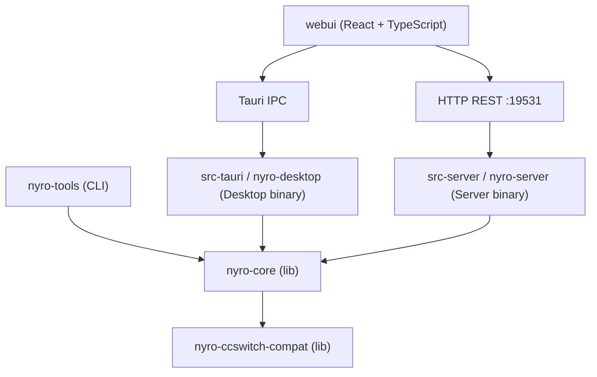

# Nyro AI Gateway — 架构设计

---

## 1. 产品定位与部署形态

Nyro 是一个 **AI 协议网关（AI Gateway）**：在 AI 客户端工具与模型提供商之间做实时协议转换与统一调度。任意使用 OpenAI / Anthropic / Gemini SDK 的客户端无需改代码，仅修改 `base_url` 即可路由到任意 LLM Provider。既可作为**桌面应用**本地零部署运行，也可作为**独立服务端**自托管或团队共享，管理与配置保持私有可控。

```
Claude Code · Codex CLI · Gemini CLI · OpenCode
     OpenAI SDK · Anthropic SDK · Gemini SDK
              Any HTTP API Client
                      ↓
              Nyro AI Gateway
            (localhost:19530)
                      ↓
    OpenAI · Anthropic · Google · DeepSeek
    MiniMax · xAI · GLM · Ollama · ...
```

**部署形态：**

| 形态 | 实现 | 适用场景 |
|---|---|---|
| Desktop | Tauri v2 桌面应用（macOS / Windows / Linux） | 个人开发者，零部署，数据不离开本机 |
| Server `--mode all` | 独立 Rust 二进制，Proxy + Admin API + 内嵌 WebUI | 自托管、团队共享（默认） |
| Server `--mode proxy` | 同上，仅启动代理端口 `:19530` | 分布式纯调度节点，无管理面 |
| Server `--mode admin` | 同上，仅启动管理端口 `:19531` | 内部系统对接控制面 |
| Server Standalone | `--config config.yaml`（`--mode` 被忽略），MemoryStorage，无 Admin / WebUI，端口取 YAML `server.proxy_port`（默认 19530） | 边缘/最小化部署，YAML 静态配置 |

> 内嵌 WebUI 由编译期 feature `embed-webui`（默认开启）控制；`cargo build -p nyro-server --no-default-features`（`make server-slim`）产出 slim 二进制，all / admin 模式均只提供 Admin API，可用 `--webui-dir` 挂载外部 WebUI 目录。
>
> 默认监听 `127.0.0.1`。`--lan` 将代理与管理监听改为 `0.0.0.0`，并强制要求 `--proxy-auth-key`（admin 启用时还需 `--admin-token`），否则拒绝启动；非 loopback 的 `--admin-host` 同样要求 `--admin-token`。`--migrate-only` 仅执行迁移后退出（适合 K8s init Job）。

核心原则：管理面 `AdminService` 只暴露纯 Rust API（struct + async fn），**不感知传输层**——Desktop 版通过 Tauri IPC 调用，Server 版通过 HTTP REST 调用。代理面的 axum Server 由 `nyro-core` 自带（`Gateway::start_proxy*`），两种外壳只负责启动它。Desktop 版不开 Admin HTTP 监听，管理操作全部走 IPC。

---

## 2. Workspace 分层

```
nyro/
├── Cargo.toml                   # Rust workspace（5 个 member）
├── crates/
│   ├── nyro-core/               # 核心库
│   │   ├── src/
│   │   │   ├── lib.rs            # 17 个顶层 pub mod + Gateway 根类型
│   │   │   ├── config.rs         # GatewayConfig / GatewayStorageConfig / SqlStorageConfig / UpstreamTimeouts
│   │   │   ├── error.rs          # GatewayError taxonomy（§7）
│   │   │   ├── proxy/            # 代理面
│   │   │   │   ├── mod.rs
│   │   │   │   ├── auth.rs       # ProxyAuth：代理面全局鉴权中间件（--proxy-auth-key）
│   │   │   │   ├── client.rs     # ProxyClient（HTTP 调用封装）
│   │   │   │   ├── client/timeouts.rs  # 读侧超时（首字节 / stream idle）
│   │   │   │   ├── context.rs    # RequestContext / ContextBag
│   │   │   │   ├── handler.rs    # models_list 只读端点（≤110 行）
│   │   │   │   ├── intake.rs     # 请求接入预处理
│   │   │   │   ├── observability.rs  # 日志与健康写入统一出口（send_log、header/URL 脱敏）
│   │   │   │   ├── security.rs   # API Key 提取 / 过期校验 / 配额辅助
│   │   │   │   ├── server.rs     # axum HTTP Server 启动
│   │   │   │   ├── stream.rs     # StreamBridge 状态机
│   │   │   │   ├── dispatcher/   # 单点编排管线
│   │   │   │   │   ├── mod.rs        # dispatch_pipeline / dispatch / error_response / LogBuilder
│   │   │   │   │   ├── auth.rs       # authorize_model_access / get_provider
│   │   │   │   │   ├── non_stream.rs # handle_non_stream / handle_non_stream_via_upstream_stream
│   │   │   │   │   ├── stream.rs     # handle_stream（SSE 直通 + IR 流式）
│   │   │   │   │   ├── stream/       # input.rs（字节→文本边界）/ sse_framer.rs（SSE 分帧）
│   │   │   │   │   ├── streaming.rs  # Native IR / Compat 流式共享生命周期（逐 delta OnResponse）
│   │   │   │   │   ├── buffered.rs   # Native IR / Raw-Wire Compat / Vendor 原生 IR 三路非流式成功响应共享收尾
│   │   │   │   │   ├── compat.rs     # Raw-Wire Compat 执行（handle_compat）
│   │   │   │   │   ├── ir_response.rs     # Vendor 原生 IR 源（VendorStream：Devin / Kiro）响应转换
│   │   │   │   │   ├── passthrough_probe.rs · stream_probe.rs  # SSE 直通预提交 hold / 零载荷终止探测
│   │   │   │   │   ├── account_pool.rs    # 账号池调度适配
│   │   │   │   │   ├── param_overrides.rs # 上游参数特例改写
│   │   │   │   │   ├── accumulator.rs
│   │   │   │   │   └── util.rs       # is_retryable 等
│   │   │   │   ├── planner/      # 协议协商
│   │   │   │   │   ├── mod.rs        # Plan + ProtocolPlan / ProtocolMode / negotiate 等 re-export
│   │   │   │   │   └── negotiator.rs # negotiate() / negotiate_required() / RoutingStrategy / OrderedStrategy
│   │   │   │   └── ingress/      # 5 个薄 ingress shell（按协议族分目录）
│   │   │   │       ├── mod.rs
│   │   │   │       ├── openai_compatible/   # chat_completions.rs · embeddings.rs（decode → dispatch_pipeline）
│   │   │   │       ├── openai_responses/    # responses.rs
│   │   │   │       ├── anthropic_messages/  # messages.rs
│   │   │   │       └── google_generative/   # generate_content.rs
│   │   │   ├── plugin/           # 扩展框架（PluginKernel + 生命周期插点）
│   │   │   │   ├── mod.rs        # PluginKernel / CapabilityKind / PluginManifest
│   │   │   │   └── phase.rs      # Phase / PhaseHook / PhaseCtx / PhaseOutcome / RequestMutated /
│   │   │   │                     # ResponseView / HostContext / ResponseStats /
│   │   │   │                     # PhaseHookRegistration / PhaseHookRegistry
│   │   │   ├── protocol/         # 协议转换引擎
│   │   │   │   ├── mod.rs        # 6 个 codec trait / SseEvent / ProviderProtocols / ResolvedEgress 等
│   │   │   │   ├── ids.rs        # Protocol / ProtocolEndpoint（别名 ProtocolId）/
│   │   │   │   │                 # EndpointCapabilities（别名 ProtocolCapabilities）/ VendorFieldPolicy
│   │   │   │   ├── traits.rs     # EndpointHandler trait
│   │   │   │   ├── registry.rs   # ProtocolRegistry / EndpointRegistration / EndpointDescriptor / ExecutionKind
│   │   │   │   ├── ir/           # 统一内部表示（IR），详见 docs/design/ir/
│   │   │   │   │   ├── mod.rs
│   │   │   │   │   ├── request.rs   # AiRequest
│   │   │   │   │   ├── response.rs  # AiResponse
│   │   │   │   │   ├── stream.rs    # StreamDelta（re-export 为 AiStreamDelta）
│   │   │   │   │   ├── usage.rs     # Usage
│   │   │   │   │   └── ...          # envelope / ext / vendor_ext / cache / error / repair / schema
│   │   │   │   └── codec/        # 编解码器 + EndpointHandler 注册壳
│   │   │   │       ├── mod.rs
│   │   │   │       ├── reasoning.rs       # reasoning effort 映射 + think-tag 提取
│   │   │   │       ├── tool_correlation.rs
│   │   │   │       ├── tool_bridge.rs
│   │   │   │       ├── openai/
│   │   │   │       │   ├── compatible/    # chat_completions + embeddings
│   │   │   │       │   └── responses/     # OpenAI Responses API
│   │   │   │       ├── anthropic/
│   │   │   │       │   └── messages/
│   │   │   │       └── google/
│   │   │   │           └── gemini/
│   │   │   ├── conversion/       # 每 target 的统一协议转换规划（见 ADR 0001）
│   │   │   │   ├── mod.rs
│   │   │   │   ├── plan.rs       # ConversionPlan::{PassThrough, NativeIr, RawWireCompat}
│   │   │   │   ├── resolver.rs   # 选路、Compat profile/session 与 ResolvedConversion
│   │   │   │   ├── prepared.rs   # PreparedBody / PreparedSession / 三策略准备
│   │   │   │   ├── outcome.rs    # ConversionAttempt / retry / health
│   │   │   │   └── wire_patch.rs # IR mutation → 原始 wire body patch
│   │   │   ├── provider/         # 厂商扩展层（§6）
│   │   │   │   ├── mod.rs
│   │   │   │   ├── vendor.rs     # Vendor trait / ProviderCtx
│   │   │   │   ├── vendor_ext.rs # VendorExtension trait / VendorCtx / VendorAsExt
│   │   │   │   ├── registry.rs   # VendorRegistry / VendorScope / VendorRegistration / ExtensionRegistration
│   │   │   │   ├── metadata.rs   # VendorMetadata / ChannelDef / AuthMode / CapabilitiesSource
│   │   │   │   ├── outbound.rs   # OutboundRequest
│   │   │   │   ├── inbound.rs    # InboundResponse
│   │   │   │   ├── native.rs     # IrUpstream / AttemptControl（Vendor::start_ir 原生双工执行）
│   │   │   │   ├── account_pool.rs  # Devin / Kiro 订阅账号池准入与亲和
│   │   │   │   ├── key_pool.rs   # 中转供应商多 Key 池 + resolve_endpoint 统一入口
│   │   │   │   ├── common/
│   │   │   │   │   ├── openai_compat.rs  # OpenAI 兼容共用 helpers（经 common::openai 别名导出）
│   │   │   │   │   ├── pipeline.rs       # build_request / parse_response / passthrough_run
│   │   │   │   │   └── effort_policy.rs  # 按上游方言规整 reasoning_effort
│   │   │   │   ├── openai/           # OpenAiVendor + OpenAIFamilyExt；codex/（OpenAiCodexChannel）
│   │   │   │   ├── anthropic/        # AnthropicVendor + AnthropicFamilyExt；claude_code/（AnthropicClaudeCodeChannel
│   │   │   │   │                     #   + egress/cloak/cch/profile/identity/tool_alias，见 §6.5a）
│   │   │   │   ├── google/           # GoogleVendor + GoogleFamilyExt + Antigravity / Gemini CLI ext
│   │   │   │   │                     # （antigravity.rs · gemini_cli.rs）
│   │   │   │   ├── xai/              # XaiVendor；grok/（XaiGrokChannel）
│   │   │   │   ├── devin/ · kiro/    # 原生协议 vendor（start_ir、账号池、用量）
│   │   │   │   ├── opencode_go/      # 三端点自适应（routing.rs · session.rs）
│   │   │   │   ├── nyro_gateway/     # Nyro 级联：对接另一个 Nyro 实例（四协议共享 Key）
│   │   │   │   ├── xiaomimimo/       # 含 passport.rs（小米账号 passToken 登录）
│   │   │   │   ├── vertexai/ · deepseek/ · moonshotai/ · kimi_code/ · zhipuai/ · zai/
│   │   │   │   └── minimax/ · ark_coding/ · bailian/ · openrouter/ · nvidia/ · ollama/ · custom/
│   │   │   ├── auth/             # OAuth / 凭据驱动框架
│   │   │   │   ├── types.rs      # AuthDriver trait / StoredCredential / RuntimeBinding / AuthSession
│   │   │   │   ├── registry.rs   # driver key 规范化与构建（codex · claude-code · grok · google ·
│   │   │   │   │                 # google-gemini-cli · devin · kiro）
│   │   │   │   └── drivers/      # claude · openai（codex）· codex_version · grok · google · devin ·
│   │   │   │                     # kiro（+ kiro/device.rs 设备授权）· shared（PKCE / state / callback）
│   │   │   ├── admin/            # AdminService 管理面（按职责拆分）
│   │   │   │   ├── mod.rs        # AdminService
│   │   │   │   ├── providers.rs · models.rs · api_keys.rs · oauth.rs · settings.rs
│   │   │   │   ├── observability.rs · import_export.rs · model_catalog.rs · model_data.rs · auth_data.rs
│   │   │   │   ├── extensions.rs # list_loaded_extensions（PluginKernel 聚合）
│   │   │   │   ├── account_pool.rs · account_test.rs · account_usage.rs · kiro_accounts.rs  # OAuth 账号池
│   │   │   │   ├── usage.rs · aliyun_sign.rs · volcengine_sign.rs  # 上游套餐/配额/余额查询与控制面签名
│   │   │   │   ├── usage_forward.rs  # nyro→nyro 用量转发（/v1/nyro/usage 报告、范围与脱敏、快照缓存）
│   │   │   │   ├── token_cost.rs · token_price.rs  # token 用量折算价值 / 人工价格
│   │   │   │   ├── model_ratings.rs · model_performance.rs  # 模型评分 / 性能页聚合
│   │   │   │   └── session_tests.rs
│   │   │   ├── router/           # 目标选择
│   │   │   │   ├── selector.rs   # TargetSelector + 4 种 RoutingStrategy（weighted / priority / latency / usage）
│   │   │   │   ├── health.rs     # HealthRegistry 熔断
│   │   │   │   ├── latency.rs    # LatencyRegistry（流式首字延迟 EWMA）
│   │   │   │   ├── quota.rs      # ProviderQuotaRegistry（用量快照与调度资格）
│   │   │   │   ├── usage.rs      # usage 策略评分
│   │   │   │   ├── decision.rs   # RouteDecision 快照（随请求日志落库）
│   │   │   │   └── matcher.rs    # ModelCache / match_model
│   │   │   ├── storage/          # 多后端存储（§10）
│   │   │   ├── db/               # SQLite 连接池 / INIT_SQL / migrate() + 共享领域 DTO（models.rs）+ TPS / 性能聚合
│   │   │   ├── logging/          # LogEntry / enqueue_log / run_collector + diagnostics（结果判定）
│   │   │   │                     # + payload（有界载荷采集、header 脱敏）
│   │   │   ├── performance/      # 与载荷无关的严格性能证据（Attempt / ProducerGuard 生命周期）
│   │   │   ├── update/           # Server 在线更新：签名清单校验（minisign，公钥编译内置）/ 检查 / 下载校验安装
│   │   │   │                     # / 启动交接决策（boot.rs）；进程 exec 由 src-server 负责（docs/server/upgrade.md）
│   │   │   ├── vision_shim/      # 视觉垫片：OnAccess PhaseHook，用 helper 模型把图片转写为文字，
│   │   │   │                     # 供纯文本目标模型使用（config / caption / ir_scan / cache / hook）
│   │   │   └── integrations/     # HookRegistry（旧版 request/response hook）
│   │   └── tests/                # 集成测试（协议转换、流式、存储、用量等）
│   ├── nyro-ccswitch-compat/    # cc-switch raw-wire 兼容层（机械移植转换核心 + CompatEngine，§3.0）
│   └── nyro-tools/              # CLI：proxy / record / replay / print-scenarios / dump-schema（§12.5）
├── src-tauri/                   # nyro-desktop：Tauri 外壳（IPC command、托盘、自动更新）
├── src-server/                  # nyro-server：Server 外壳（Admin REST 路由、YAML standalone、内嵌 WebUI、
│                                #   self_update.rs：启动交接与更新后 exec 重启）
├── webui/                       # React 管理台（§11）
├── tests/                       # Python E2E（pytest）+ WebUI smoke 脚本
└── deploy/schema/               # 由迁移生成的 PostgreSQL / MySQL 最终态参考 schema
```

**依赖关系：**



**nyro-core 顶层 `pub mod`（lib.rs，共 16 个）：**

```
admin · auth · config · conversion · db · error · integrations · logging
performance · plugin · protocol · provider · proxy · router · storage · vision_shim
```

**核心 API：**

```
Gateway::new(config)               → (Gateway, Receiver<LogEntry>)
                                     连接存储并 init/migrate，启动后台任务
                                     （models.dev 刷新、provider 用量监控、OAuth 刷新与会话清理、
                                     配置 epoch 轮询）；不启动代理
Gateway::from_storage(config, st)  → 同上，注入外部 Storage（standalone 用 MemoryStorage）
Gateway::start_proxy()             → 启动 axum 代理面（永不返回）
Gateway::start_proxy_with_shutdown(fut) → 同上，fut 完成时优雅关闭（Server 版使用）
Gateway::admin()                   → 返回 AdminService，提供全部管理操作
  ├── .list_models()
  ├── .create_model(input)
  ├── .list_providers()
  ├── .create_provider(input)
  ├── .test_provider(id)
  ├── .list_api_keys()
  ├── .query_logs(query)
  ├── .get_stats_overview(range)
  ├── .list_loaded_extensions()  ← PluginKernel 聚合 manifest
  └── ...
```

`Gateway::new` 返回的 `Receiver<LogEntry>` 由外壳交给 `logging::run_collector` 消费落库。

`AdminService` 是管理面唯一入口；`admin/` 子模块按功能职责分布，不引入新传输层抽象。

---

## 3. 协议转换架构

### 3.0 cc-switch 兼容层（raw-wire parity）

跨协议转换的线级行为由 `crates/nyro-ccswitch-compat` 提供：该 crate 从 cc-switch（commit `eb69e492`，MIT）机械移植了全部转换核心（`transform_*`、`streaming_*`、SSE 工具、内容解码等，含内嵌测试），并封装为字节进字节出的 `CompatEngine`（实例挂在 `Gateway.compat_engine`）。`nyro-core` 的 `conversion/resolver.rs`（`supports_raw_wire_compat` / `resolve_raw_wire_compat`）在以下方向选用该引擎，由 `proxy/dispatcher/compat.rs`（`handle_compat`）执行，绕过 IR 往返以获得与 cc-switch 完全一致的线级行为：

| ingress → egress | 说明 |
|---|---|
| Anthropic Messages → OpenAI Chat / Responses / Gemini | Claude Code 客户端接 OpenAI/Gemini 系上游；→ Responses 按 vendor/channel 区分 `CodexOAuthResponses`（codex 直连 / sub2api 中转）、`XaiStrictResponses`、`StandardResponses` 三种 `UpstreamFlavor` |
| OpenAI Responses → OpenAI Chat / Anthropic Messages | Codex 客户端接 Chat 或 Claude 系上游；→ Anthropic 时剥离模型名 `[1m]` 后缀并开启 1M 上下文 |
| OpenAI Responses → Responses（xai） | xAI 原生 Responses 的 namespace 扁平化/还原与 xAI sanitize |
| OpenAI Responses → Responses（第三方：非 openai / codex / sub2api / xai） | 仅当请求含需改写的 Codex Responses 产物（`request_needs_rewrite`）时启用：工具改写 + `PortableInline` 历史回放策略；否则走原生路径 |
| Anthropic Messages → Anthropic Messages（DeepSeek/MiMo 系） | 同协议直通 + cc-switch 的 thinking 历史回放归一化与 DeepSeek 官方 effort 剥离 |

所有方向只对 `ExecutionKind::JsonHttp` 端点生效；Google `antigravity` / `gemini-cli` 订阅通道强制走 IR 管线（需要 vendor 响应钩子解包信封，compat 路径会绕过这些钩子）。

对齐程度由 `scripts/check_cc_switch_parity_inventory.py` 审计 `crates/nyro-ccswitch-compat/tests/parity_inventory.toml`（1168 个源测试：508 直接移植（migrated）+ 152 断言级映射（mapped）+ 508 经批准排除（not-applicable）），以 `--require-complete` 作为完整性门禁（目标测试改动后需用 `--update-target` / `--update-targets` 刷新 `target_sha256`）。完整的移植分析、模块映射与维护指南见 [cc-switch-porting-report.md](./cc-switch-porting-report.md)。

### 3.1 核心设计原则

- **统一错误 taxonomy**：`GatewayError` 覆盖 14 种错误类型（见 §7），每个错误有稳定 code（`stable_code()`）、HTTP status、面向客户端的脱敏 message 和 retryable 标志；内部细节保留在变体字段中（如 `Internal { source }`、`UpstreamStatus.body`）。
- **请求生命周期追踪**：`RequestContext` 携带 request_id、deadline、cancellation token、outcome，以及类型键扩展袋 `ContextBag`，端到端贯穿所有层（见 §4）。
- **确定性协议协商**：`negotiate()`（`proxy/planner/negotiator.rs`）依次尝试 路由级偏好（provider 声明时）→ 与 ingress 完全一致的 provider endpoint → provider 默认 endpoint（需转换；embeddings 不跨协议）→ `ProtocolUnsupported`；`negotiate_required()` 用于必须命中指定端点的场景（如 OpenCode Go，见 §6.6）。`ProtocolRegistry` 统一别名规范化。
- **Pass-Through 已落地**：`ingress == egress` 且对应 leg 无 mutation 时，dispatcher 绕过跨协议 IR 往返；请求侧保留解析后的原生 JSON 并应用窄范围默认值/安全归一化，响应侧在安全时直接转发 body / SSE 字节。
- **完整字段映射**：每个 codec 明确处理已知字段；vendor-specific 字段走三段化路径，不隐式丢弃。
- **Vendor 单点接口**：`dispatch_pipeline` 主要通过 `Vendor` trait（`VendorRegistry::get_vendor`）与厂商层交互，一次注册覆盖请求/响应编解码与流式处理的完整生命周期；另经 `VendorRegistry::resolve` 取 `VendorExtension` 规范化出站 URL（见 §6.2）。
- **五阶段生命周期**：请求/响应全程经过 OnRequest / OnAccess / OnUpstream / OnResponse / OnLog 五个插点，通过 `PhaseHook` 做非侵入扩展（见 §4）。

### 3.2 完整调用流程

```
+--------------------+                  +------------------------------------------+
| Client / CLI / SDK | -- HTTP/SSE --> | Ingress Shell（proxy/ingress/<family>/）   |
|                    |                  |  RequestContext 注入（axum Extension）      |
|                    |                  |  decode body → AiRequest（IR）             |
+--------------------+                  +-------------------+----------------------+
                                                            |
                                                            ▼
                                         +------------------------------------------+
                                         | dispatch_pipeline（薄包装）               |
                                         |  HostContext::new(&gw)                    |
                                         |  ↓ dispatch_pipeline_inner(ctx, req, host)|
                                         +-------------------+----------------------+
                                                            |
                                  ┌─ Phase ①  OnRequest ───┤  路由键派生前
                                  │  PhaseHook chain        │  可改写 request.model
                                  │  ShortCircuit → 直接返回 │  Reject → 渲染错误
                                  └─────────────────────────┤
                                                            │
                                              Route lookup（model_cache）
                                              Auth / Quota（authorize_model_access）
                                                            │
                                  ┌─ Phase ②  OnAccess ────┤  身份 + 路由已定
                                  │  PhaseHook chain        │  可 Reject（限流/鉴权策略）
                                  └─────────────────────────┤
                                                            │
                                         Target iteration（HealthRegistry 感知）
                                                            │
                                  ┌─────────── 每个 target ──────────────────────┐
                                  │  negotiate() → egress / base_url              │
                                  │  VendorRegistry.get_vendor(vendor_id)         │
                                  │                                               │
                                  │  ┌─ Phase ③  OnUpstream ──────────────────┐  │
                                  │  │  per-attempt（重试循环内）               │  │
                                  │  │  可 ShortCircuit（缓存命中）             │  │
                                  │  │  Reject → 记录并跳到下一个 target        │  │
                                  │  └────────────────────────────────────────┘  │
                                  │                                               │
                                  │  conversion：PassThrough | Native IR | Compat │
                                  │  provider_ctx = ProviderCtx{...}              │
                                  │  build outbound（passthrough_run | 7 步）      │
                                  │  CallCtx{ req_ext = ctx.extensions.clone() }  │
                                  │                                               │
                                  │  ┌────────────── handlers ──────────────────┐ │
                                  │  │ ExecutionKind::VendorStream（Devin/Kiro）│ │
                                  │  │  → adapter.start_ir                       │ │
                                  │  │    → ir_response::handle_ir_response      │ │
                                  │  │ Raw-Wire Compat 选中                      │ │
                                  │  │  → compat::handle_compat                  │ │
                                  │  │        ┌─ Phase ④ OnResponse ────────┐  │ │
                                  │  │ is_stream                                 │ │
                                  │  │  → handle_stream                          │ │
                                  │  │    · IR path: spawn 内逐 AiStreamDelta    │ │
                                  │  │        ┌─ Phase ④ OnResponse(Stream) ─┐  │ │
                                  │  │    · SSE passthrough: 不接 OnResponse   │ │
                                  │  │ force_upstream_stream / Google 订阅通道   │ │
                                  │  │  → handle_non_stream_via_upstream_stream  │ │
                                  │  │        ┌─ Phase ④ OnResponse(Full) ──┐  │ │
                                  │  │ else                                     │ │
                                  │  │  → handle_non_stream                     │ │
                                  │  │        ┌─ Phase ④ OnResponse(Full) ──┐  │ │
                                  │  └──────────────────────────────────────────┘ │
                                  │  各路径均 LogBuilder.emit()                    │
                                  │    └▶ 注入 ResponseStats → ctx.extensions     │
                                  │  status<400 → record_success, return          │
                                  │  retryable → continue; else → return          │
                                  └───────────────────────────────────────────────┘
                                                            │
                                         ┌─ Phase ⑤  OnLog ┤  单一汇聚点（所有返回路径）
                                         │  fire-and-forget │  只读 ctx.extensions 的
                                         │  不可改/不可短路  │  ResponseStats 快照
                                         └──────────────────┤
                                                            │
                                              Return to Client（JSON / SSE）
```

### 3.3 内部表示（IR）

位于 `crates/nyro-core/src/protocol/ir/`，定义统一内部结构：

- `AiRequest`（`ir/request.rs`）：入站请求，含消息列表、工具定义、模型参数
- `AiResponse`（`ir/response.rs`）：出站响应，含 content / tool_calls / usage / reasoning_content
- `AiStreamDelta`（`ir/stream.rs` 的 `StreamDelta`，经 `ir/mod.rs` re-export）：流式增量事件，支持 reasoning delta、text、tool_call
- `Usage`（`ir/usage.rs`）：prompt_tokens / completion_tokens / total_tokens / cache_read_tokens / cache_creation_tokens / reasoning_tokens / server_tool_use

字段归属（typed 字段 / `AiRequest.ext: Option<ProtocolExt>` / vendor 扩展袋）的决策见 [ir/FIELD_HOMING.md](ir/FIELD_HOMING.md)，IR 演进见 [ir/README.md](ir/README.md)。

**vendor-specific 字段命名约定（存于 `AiRequest.meta.vendor.ingress`）：**

| 前缀 | 用途 |
|---|---|
| `__anthropic_raw_*` | Anthropic messages / system / tools 原样往返（cache_control、exotic blocks 无损） |
| `__google_raw_*` | Google systemInstruction / built-in tools 原样往返 |
| `__google_*` | 其余 Google 字段：`__google_generation_config`（encoder 中被 model 参数 overlay）、`__google_safety_settings`、`__google_tool_config`、`__google_cached_content` 等 |
| `__emb_*` | Embeddings 已知字段（input / dimensions / encoding_format / user） |
| `__vendor_ingress` | 未知 vendor 字段集合（由 VendorFieldPolicy 决定是否转发） |

---

## 4. 请求生命周期与扩展框架

> 权威设计文档：[docs/design/lifecycle.md](lifecycle.md)。本节提供概要，细节以 RFC 为准。

### 4.1 五阶段定义

| 阶段 | 时机 | 可做的事 | PhaseOutcome |
|---|---|---|---|
| **OnRequest** | 路由键派生前 | 改写 `request.model` / IR 字段（`PhaseCtx` 不暴露 HTTP 头） | Continue / ShortCircuit / Reject |
| **OnAccess** | 鉴权完成后 | 限流拒绝、自定义 ACL、IR 改写（如 vision_shim） | Continue / ShortCircuit / Reject |
| **OnUpstream** | 上游调用前，per-attempt | 缓存命中短路、参数注入 | Continue / ShortCircuit / Reject（仅跳过当前 target，继续下一个） |
| **OnResponse** | 响应解码后（非流式: Full；流式: 逐 delta） | 整形输出、屏蔽字段、写缓存 | Continue / ShortCircuit / Reject（非流式；Reject 归一为 `ShortCircuit(error.render)` 且不计入健康失败）；仅 Continue（流式，其余结果忽略） |
| **OnLog** | 管线边界（所有返回路径汇聚后） | 只读采样、指标上报、外部投递 | Continue（终态，不可短路） |

### 4.2 核心类型

```rust
// 钩子接口（inventory::submit! 注册，进程内静态链接）
#[async_trait]
pub trait PhaseHook: Send + Sync {
    fn name(&self) -> &'static str;
    fn phase(&self) -> Phase;
    async fn run(&self, ctx: &mut PhaseCtx<'_>) -> PhaseOutcome;
}

// 每次调用时传给 hook 的上下文四件套
pub struct PhaseCtx<'a> {
    pub req_ctx:  &'a mut RequestContext,  // 端到端请求上下文（含 ContextBag）
    pub request:  &'a mut AiRequest,       // 协议中性 IR
    pub response: ResponseView<'a>,        // Pending / Full / Stream
    pub host:     &'a HostContext<'a>,     // 网关能力边界（存储/配置/HTTP 等）
}

// ResponseStats: emit() 单点注入，OnLog 及 OnLogHook 读取
pub struct ResponseStats {
    pub client_status:       u16,
    pub upstream_status:     Option<u16>,
    pub usage:               Usage,
    pub upstream_latency_ms: Option<i64>,
    pub ttfb_ms:             Option<i64>,
    pub stream_chunks:       u32,
}
```

### 4.3 数据通道

```
RequestContext.extensions: ContextBag
  └─ 类型键（TypeId）→ Box<dyn Any + Send + Sync>
     共享引用（Arc<Mutex<HashMap>>），clone 后仍指向同一份数据

写入：LogBuilder::emit() → ctx.extensions.insert::<ResponseStats>(...)
读取：OnLog / OnLogHook → ctx.extensions.get::<ResponseStats>()
```

### 4.4 PluginKernel 与 admin 视图

`PluginKernel`（`plugin/mod.rs`）聚合所有 `inventory` 注册表：

```
PluginKernel::global()
  ├── HookRegistry（旧版 integrations）
  ├── VendorRegistry
  ├── ProtocolRegistry
  └── PhaseHookRegistry
        → manifests() → [{id, capability}]
              ↓
        GET /api/v1/system/extensions
        Tauri: get_loaded_extensions
        WebUI: /extensions 只读页
```

### 4.5 框架级 vs 插件级（当前状态）

```
框架级 ✅ 已交付
  五个 PhaseHook 插点接线（OnRequest/OnAccess/OnUpstream/OnResponse/OnLog）
  RequestContext.extensions（ContextBag）端到端贯穿
  ResponseStats 单点注入（emit()）
  HostContext 稳定边界
  PhaseHookRegistry（inventory 注册，无 hook 时零开销 no-op）
  PluginKernel + admin "已加载扩展" 只读视图
  RequestMutated 标记：hook 改写 IR 后强制走重编码路径（不再 PassThrough）

插件级 ✅ 已有
  vision_shim（VisionShimHook，OnAccess）：用 helper 模型把图片转写为文字后
  交给纯文本目标模型，并标记 RequestMutated——生产环境唯一内置的 PhaseHook，
  因此注册表在生产中不为空

插件级 🔲 待做（A4）
  限流插件（OnAccess → Reject）
  语义缓存插件（OnUpstream ShortCircuit + OnResponse 落缓存）
  可观测性 exporter（OnLog 消费 ResponseStats → OTel / Prometheus）
```

---

## 5. 协议层（codec/）详情

### 5.1 EndpointHandler 注册体系

每个 dialect 的注册壳位于 `codec/<family>/<dialect>/` 对应目录，通过 `inventory::submit!` 自动注册进 `ProtocolRegistry`：

```rust
inventory::submit! {
    EndpointRegistration { make: || Box::new(XxxHandler) }
}
// ProtocolRegistration 为 EndpointRegistration 的向后兼容别名
```

`ProtocolEndpoint` 的规范 Display 形式为 `{protocol}/{name}/{version}`；旧 ID 作为别名仍可解析（`protocol/registry.rs`）：

| 目录 | 注册的 ProtocolEndpoint（常量） | 旧别名 |
|---|---|---|
| `codec/openai/compatible/` | `openai-compatible/chat-completions/v1`（`OPENAI_COMPATIBLE_CHAT_COMPLETIONS_V1`）、`openai-compatible/embeddings/v1` | `openai/chat/v1`、`openai/embeddings/v1` |
| `codec/openai/responses/` | `openai-responses/responses/v1`（`OPENAI_RESPONSES_V1`） | `openai/responses/v1` |
| `codec/anthropic/messages/` | `anthropic-messages/messages/2023-06-01`（`ANTHROPIC_MESSAGES_2023_06_01`） | `anthropic/messages/2023-06-01` |
| `codec/google/gemini/` | `google-gemini/generate-content/v1beta`（`GOOGLE_GEMINI_GENERATE_CONTENT_V1BETA`） | `google/generate/v1beta` |

另有两个 descriptor-only 的 egress 端点，无 codec 目录与 `EndpointHandler`，`ExecutionKind::VendorStream`，由 vendor 的 `start_ir` 原生执行（见 §6.1）：`devin-chat/get-chat-message/v1`（`DEVIN_CHAT_V1`）、`kiro-chat/generate-assistant-response/v1`（`KIRO_CHAT_V1`）。

`ProtocolId` 现为 `ProtocolEndpoint`（`protocol/ids.rs`）的类型别名，保持向后兼容。

### 5.2 EndpointHandler trait 与 codec trait

`EndpointHandler`（原 `ProtocolHandler`，`protocol/traits.rs`）：

```rust
pub trait EndpointHandler: Send + Sync + 'static {
    fn id(&self) -> ProtocolEndpoint;
    fn capabilities(&self) -> &'static EndpointCapabilities;
    fn protocol(&self) -> Protocol { self.id().protocol }   // 默认由 id() 推导
    fn make_request_decoder(&self)         -> Box<dyn RequestDecoder + Send>;
    fn make_request_encoder(&self)         -> Box<dyn RequestEncoder + Send>;
    fn make_response_decoder(&self)        -> Box<dyn ResponseDecoder>;
    fn make_response_encoder(&self)        -> Box<dyn ResponseEncoder>;
    fn make_stream_response_decoder(&self) -> Box<dyn StreamResponseDecoder>;
    fn make_stream_response_encoder(&self) -> Box<dyn StreamResponseEncoder>;
}
```

6 个 codec trait 定义在 `protocol/mod.rs`：`RequestDecoder`、`RequestEncoder`、`ResponseDecoder`、`ResponseEncoder`、`StreamResponseDecoder`、`StreamResponseEncoder`。流式解析在 protocol 层（`StreamResponseDecoder::parse_chunk` / `finish`），**非** Vendor 层。

### 5.3 EndpointCapabilities 矩阵（别名 ProtocolCapabilities）

| 字段 | 类型 | 含义 |
|---|---|---|
| `streaming` | bool | 支持 SSE 流式 |
| `stream` | StreamCaps | 流式细节：`server_sent_events` / `usage_in_stream` / `requires_stream_flag` |
| `tools` / `function_calling` | bool | 支持 tool call |
| `parallel_tool_calls` | bool | 支持并行工具调用 |
| `reasoning` / `extended_reasoning` | bool | 支持 thinking / reasoning |
| `multimodal` | bool | 接受多模态（视觉）输入 |
| `structured_output` | bool | 支持结构化输出 / JSON mode |
| `deterministic_seed` | bool | 支持 `seed` |
| `embeddings` | bool | Embeddings 端点 |
| `force_upstream_stream` | bool | 强制上游 streaming（Responses API、Devin Chat） |
| `override_model_in_body` | bool | 仅 Google 为 true（字段注释与 codec 注释描述不一致，当前无运行时读取方） |
| `ingress_routes` | `&[(method, path)]` | 该 handler 认领的入口路由，供 `ProtocolRegistry::find_by_ingress_route` 声明式路由 |
| `unknown_field_policy` | VendorFieldPolicy | `Supported` / `Drop` / `Unknown` |
| `lossy_default_reject` | bool | lossy 转换默认拒绝——当前 `negotiate()` 仅 trace 记录，未强制拒绝 |

### 5.4 Codec 完整字段映射

**OpenAI Chat**：完整映射 logprobs、seed、response_format、parallel_tool_calls、audio 等 20+ 字段；reasoning 字段透传。

**OpenAI Responses**：`force_upstream_stream=true`；独立 decoder/encoder/parser/formatter；reasoning_item 的 summary text 提取。

**Anthropic Messages**：cache_control、thinking config、context_management、exotic blocks（Document / InputAudio）保留 `__anthropic_raw_*` 做无损往返；built-in tools（web_search_call）作为 sentinel ToolDef 处理。

**Google GenerateContent**：完整 generationConfig（20+ fields）、safety_settings、built-in tools（googleSearch / codeExecution）；`__google_generation_config` 在 encoder 中被 model 参数 overlay。

**OpenAI Embeddings**：`VendorFieldPolicy::Drop`；`__emb_*` 明确解析；unknown fields 进 `__vendor_ingress` 但不转发。

### 5.5 语义工具（codec/reasoning.rs & codec/tool_correlation.rs）

**reasoning.rs**：
- `normalize_response_reasoning`：结构化字段优先，`<think>` tag 兜底提取
- `split_think_tags`：多 `<think>` block 支持，未闭合 tag 保留为文本

**tool_correlation.rs**：`normalize_request_tool_results`，统一 tool_call_id 关联（精确 ID → content hint → 工具名 hint → FIFO fallback → 自动补合成 assistant message）。

---

## 6. 厂商扩展层（provider/）

三层职责分离：

```
protocol/codec/       ← 序列化层：AiRequest/AiResponse ↔ wire-format JSON
provider/             ← 编排层：Vendor trait（build_request / parse_response / start_ir）+ VendorExtension hooks
proxy/dispatcher/     ← 调度层：选 target、协议协商、转换策略（passthrough / IR / compat）、重试与日志
```

### 6.1 Vendor trait（原 ProviderAdapter）

dispatcher 经 `VendorRegistry::get_vendor(vendor_id)`（大小写不敏感）取得 `Vendor`（`provider/vendor.rs`）。所有 hook 均有默认实现并返回 `anyhow::Result<()>`；必须实现的只有 `scope` / `vendor_id` / `supported_protocols` / `build_request` / `parse_response` / `map_error`：

```rust
#[async_trait]
pub trait Vendor: Send + Sync + 'static {
    // 标识 / 元数据
    fn scope(&self) -> VendorScope;                         // Vendor{vendor_id} | Channel{vendor_id, channel_id}
    fn metadata(&self) -> Option<&'static VendorMetadata> { None }
    fn vendor_id(&self) -> &'static str;
    fn supported_protocols(&self) -> &'static [ProtocolId];

    // Auth / URL（同步）
    fn auth_headers(&self, ctx: &VendorCtx) -> HeaderMap;
    fn build_url(&self, ctx: &VendorCtx, base_url: &str, path: &str) -> String;

    // 编解码 hook（可选，默认 Ok(())）
    async fn pre_request(&self, ctx: &VendorCtx, req: &mut AiRequest, gw: &Gateway);
    async fn pre_encode(&self, ctx: &VendorCtx, req: &mut AiRequest);
    async fn post_encode(&self, ctx: &VendorCtx, body: &mut Value, headers: &mut HeaderMap);
    async fn pre_parse(&self, ctx: &VendorCtx, body: &mut Value);
    async fn post_parse(&self, ctx: &VendorCtx, resp: &mut AiResponse);

    // 流式 hook（raw chunk 可变，供 Google 订阅通道解包信封）
    async fn on_stream_raw_chunk(&self, ctx: &VendorCtx, chunk: &mut String);
    async fn on_stream_delta(&self, ctx: &VendorCtx, delta: &mut AiStreamDelta);

    // 编排
    async fn build_request(&self, req: &mut AiRequest, ctx: &ProviderCtx)
        -> Result<OutboundRequest, GatewayError>;
    async fn parse_response(&self, resp: InboundResponse, ctx: &ProviderCtx)
        -> Result<AiResponse, GatewayError>;
    fn map_error(&self, status: u16, body: Value) -> GatewayError;
    fn validate_environment(&self, provider: &Provider) -> Result<(), GatewayError> { Ok(()) }

    // 原生双工执行（Devin / Kiro 覆盖；默认返回 ProviderUnavailable）
    async fn start_ir(&self, request: AiRequest, ctx: &ProviderCtx,
                      transport: ProxyClient, control: AttemptControl)
        -> Result<IrUpstream, GatewayError>;

    // PassThrough 声明（默认 true = 保守；为 false 且 Native 时 dispatcher 走 passthrough）
    fn declared_request_mutations(&self) -> bool { true }
    fn declared_request_mutations_for(&self, provider: &Provider) -> bool;   // dispatcher 实际调用，可按 channel 区分
    fn declared_response_mutations(&self) -> bool { true }
    fn declared_response_mutations_for(&self, provider: &Provider) -> bool;
}
```

**build_request pipeline**（`provider/common/pipeline.rs::build_request`）：先将 `req.model` 置为 `actual_model`，然后：

1. `pre_request`
2. `normalize_request_tool_results`
3. `pre_encode`
4. codec encode
5. `post_encode`，随后是 wire 级修正子步骤：MiniMax / Google 输出 token 下限 → 5a `apply_max_tokens_floor` → 5b `maybe_inject_openai_fast_mode` → 5c–5e Codex 消费级参数 / reasoning content / 工具调用 ID 清洗 → `apply_vendor_effort_policy` → 5f `antigravity::apply_tier_model_rewrite` → 5g `antigravity::apply_thought_signature_policy`
6. `auth_headers`（`disable_default_auth` 时跳过；Anthropic 协议下 Bearer 改写为 `x-api-key`；合并 encoder extra headers）
7. `build_url` + `apply_explicit_auth_scheme`（按端点 `auth_scheme`：bearer / x-api-key / query / none）

`parse_response`：`pre_parse` → codec parse → `normalize_response_reasoning` → `post_parse`。`passthrough_run`：Native 且 vendor 未声明 mutation 时跳过 IR，仅替换 model 并应用少量协议默认值。

**ProviderCtx**（`provider/vendor.rs`，可经 `to_vendor_ctx()` 转为 `VendorCtx`）：

```rust
pub struct ProviderCtx<'a> {
    pub provider:             &'a Provider,
    pub protocol:             ProtocolId,        // 即 ProtocolEndpoint
    pub egress_base_url:      &'a str,
    pub api_key:              &'a str,
    pub auth_scheme:          &'a str,           // 端点认证策略：auto / bearer / x-api-key / query / none
    pub actual_model:         &'a str,
    pub force_max_reasoning:  bool,              // 模型级强制最大推理档
    pub credential:           Option<&'a StoredCredential>,
    pub gw:                   &'a Gateway,
    pub disable_default_auth: bool,
}
```

### 6.2 VendorExtension（channel / family ext）

`VendorExtension`（`provider/vendor_ext.rs`）仍存在，包含 9 个 hook（auth_headers / build_url / pre_encode / post_encode / pre_parse / post_parse / on_stream_raw_chunk / on_stream_delta / pre_request）。

**关系：**
- `Vendor` 通过 blanket `impl<T: Vendor> VendorExtension for T` 自动实现 `VendorExtension`
- 仅 impl `VendorExtension` 的类型：
  - channel 级：`OpenAiCodexChannel`（openai/codex）、`AnthropicClaudeCodeChannel`（anthropic/claude-code）、`XaiGrokChannel`（xai/grok）、`GoogleAntigravityExt`（google/antigravity）、`GoogleGeminiCliExt`（google/gemini-cli）
  - vendor 级 family fallback：`OpenAIFamilyExt` / `AnthropicFamilyExt` / `GoogleFamilyExt`（与完整 vendor 同 vendor_id，解析时完整 vendor 优先，实际很少命中）

**两套注册（均通过 `inventory::submit!`）：**

```rust
// 完整 vendor
inventory::submit! { VendorRegistration { make: || Box::new(XxxVendor) } }
// Channel / family ext
inventory::submit! { ExtensionRegistration { make: || Box::new(XxxChannel) } }
```

`VendorRegistry::resolve(provider, protocol_id) -> Option<&Arc<dyn VendorExtension>>` 按 Channel → Vendor → 协议默认 vendor（`protocol_default_vendor`：OpenAI* → openai、Anthropic → anthropic、Gemini → google、DevinChat → devin、KiroChat → kiro）三级解析；dispatcher 用其 `build_url` 规范化出站 URL，admin / auth 路径用其同步 hook。完整 vendor 在注册表构建时预包装为 `VendorAsExt`（仅转发 scope / metadata / auth_headers / build_url，异步 hook 为默认 no-op）。

### 6.3 共用 helpers（provider/common/）

- `openai_compat.rs`（经 `common::openai` 别名导出）：`openai_bearer_auth_headers`、`openai_build_url`（base 已以 `/vN` 结尾时去重 `/v1`）、`openai_map_error`、`GenericOpenAICompatibleAdapter`（仅 custom 使用）。
- `pipeline.rs`：`build_request` / `parse_response` / `passthrough_run`，所有 JSON 型 vendor 委托于此。
- `effort_policy.rs`：按上游方言规整 `reasoning_effort`（pipeline 中的 `apply_vendor_effort_policy`）。

DeepSeek / Moonshot / GLM 等 OpenAI 兼容厂商直接实现 `Vendor`，组合上述 helpers 与 `pipeline::*`，不经 `GenericOpenAICompatibleAdapter`。

### 6.4 厂商列表

| 厂商 | vendor_id | 特殊处理 |
|---|---|---|
| OpenAI | `openai` | channel：`default`、`sub2api`（Responses 中转，API Key）、`codex`（OAuth，`OpenAiCodexChannel`） |
| Anthropic | `anthropic` | `x-api-key` + `anthropic-version`；含 `claude-code` channel |
| Google | `google` | default channel：URL 追加 `?key=<api_key>`；含 `antigravity` channel（Google AI Pro 订阅 OAuth，见 6.5）与 `gemini-cli` channel（Gemini CLI / Code Assist 订阅 OAuth，见 6.5） |
| Vertex AI | `vertexai` | Service Account JSON 存于 api_key，经 `gcp_auth` 换取 access token 后以 Bearer 发送；`{project}` 取自 SA JSON；预设为 `locations/global`；channel：`native`（Gemini）/ `openai`（OpenAI 兼容） |
| DeepSeek / Moonshot / GLM (zhipuai) / MiniMax / ZAI / OpenRouter / Nvidia / Ollama | 各自 vendor_id | 直接实现 `Vendor`，组合 `openai_*` helpers + `pipeline::*`（见 6.3）；额外 channel：moonshotai / minimax `china`，zhipuai / zai `coding`；MiniMax 在 post_encode 补推理默认值并声明请求 mutation；Ollama 在 pre_request 探测模型能力并剥离不支持的 tools |
| xAI | `xai` | `default`（API Key，chat + responses）；`grok` channel（Grok 订阅 OAuth，`cli-chat-proxy.grok.com`，`XaiGrokChannel`，auth driver `grok`）；用量后端 `grok_plan` |
| Kimi Code | `kimi-code` | `api.kimi.com/coding`；chat + anthropic 共享 Key；用量后端 `kimi_coding_plan` |
| 火山方舟 Coding Plan | `ark-coding` | chat + responses + anthropic 共享 Key；anthropic 端点 auth_scheme 固定 bearer；精选静态模型与 `/models` 合并；用量后端 `ark_coding_plan`（控制面签名 `admin/volcengine_sign.rs`） |
| 阿里百炼 | `bailian` | `default`（dashscope 按量）/ `coding`（token-plan 百炼套餐）；chat + anthropic 共享 Key；用量后端 `bailian_coding_plan`（控制面签名 `admin/aliyun_sign.rs`） |
| 小米 MiMo | `xiaomimimo` | chat + responses + anthropic 三协议（anthropic 出口固定 Bearer）；channel：`default` / `token-plan-cn` / `token-plan-sgp` / `token-plan-ams`；用量查询后端 `mimo_balance` / `mimo_token_plan`（admin/usage.rs）凭控制台 Cookie（旧版，~24h 过期）或**小米账号 passToken + userId**（推荐）——`provider/xiaomimimo/passport.rs` 用 passToken 走 account.xiaomi.com serviceLogin（sid=`api-platform`，`clientSign` = sha1 签名经 base64+urlencode）→ STS 跳转链收集 `Set-Cookie` 换取 `api-platform_serviceToken`，结果按 provider 缓存 30 分钟、会话拒绝（HTTP 401/403、console code 401/403、登录重定向）时自动重签重试一次；凭据更新即失效缓存 |
| Devin | `devin` | 原生 Connect/protobuf 出站（`devin-chat/get-chat-message/v1`，固定上游 `https://server.codeium.com`），不走 OpenAI 兼容适配器；OAuth session token（`devin-session-token$…`）不可刷新。**用量查询后端** `devin_plan`（`admin/usage.rs`，仅按 `vendor=devin` 身份识别、无 URL 兜底）复用连接测试的同一个 `GetUserStatus` 一元调用（`provider/devin/usage.rs` 宽容解码：未知字段跳过，已声明字段 wire type 不符则整体失败，避免把 schema 漂移误读成「额度用完」）：`level` 取套餐名（如 `Pro`）；`daily` / `weekly_limit` 两个窗口（上游给**剩余**百分比，映射时取反为已用；重置时间为 Unix 秒）；**超额余额**（微美元）映射为唯一一条 USD `balances`。proto3 省略 0 值，故「剩余 0%」与「无数据」在 wire 上无法区分：窗口仅当「未被套餐隐藏，且（有重置时间 或 计费策略为 QUOTA）」时才成立，成立而百分比缺失即视为已用 100%；负百分比是「不限」哨兵、整窗跳过；积分计费套餐不产出窗口。**可用性 = 窗口有余量 或 超额余额>0**：窗口用完时，仅当超额余额为 $0 才暂停调度（到该窗口重置时刻）；余额>0 则经 `ProviderQuotaRegistry::observe_with_reserve` 保持可调度并标记 `on_reserve`（真实窗口快照仍保留，复查周期缩短为 60s 以便尽快发现余额耗尽）。`usage` 均衡策略下 `on_reserve` 的 Provider 排在已评分池与未知池之后、已暂停项之前（超额按真钱计费，只作最后备选，且不受另一窗口余量影响）；`priority` / `weighted` / `latency` 不感知该状态。`is_available` 恒为 `Some(true)`（Devin 无账号级可用性标志，耗尽由 tiers + 超额余额表达，与 Grok/Google 一致）。OAuth 后端，在用量监控白名单内（无需 API key）。单 Provider 多账号池见 [devin-account-pool_CN.md](devin-account-pool_CN.md)。 |
| OpenCode Go | `opencode-go` | 三端点自适应（chat/responses/messages，共享 Key）+ 按模型的硬编码端点路由；每个请求必须携带会话标识 `x-opencode-session`（见 6.6） |
| Kiro | `kiro` | 固定 `ide` OAuth 通道，原生 `kiro-chat/generate-assistant-response/v1` 出站（JSON → AWS EventStream），descriptor-only `VendorStream` 不注册入口、不走 JSON passthrough。`auth/drivers/kiro/device.rs` 实现 Google/GitHub Social 设备授权（`/oauth/device/authorization` → `/oauth/device/poll`）及 Builder ID/IdC OIDC（register → device_authorization → token），无需回调监听。初始化接收 typed `kiro` 选项（method/region/idc_region/start_url）；同一 driver 接受 device scheme 与历史导入 scheme，凭证刷新保留原 scheme。仅 server state 保存 deviceCode/clientSecret，公开 userCode/verification URL；单会话限流、slow_down 持续退避、取消代际检查、最长300s且不延长上游期限。`auth/drivers/kiro.rs` 保留 token/client-registration JSON、Social Refresh Token、`ksk_` 静态 Key 导入；Social/OIDC 自动刷新，区域由凭证决定。`provider/kiro/request.rs` 消费经过 ToolRoutePlan 改写的规范工具调用，并关联 Gemini 多工具结果；`eventstream.rs` 校验帧 CRC，`stream.rs` 拒绝已知事件的损坏 JSON，防止 EOF 假成功。`admin/usage.rs` 的 `kiro_plan` 仅按 vendor 身份识别，调用 `getUsageLimits`，同一资源的基础/有效 bonus/trial 合并为总池用于调度，明细仅展示；总池耗尽时只有显式上游 overageEnabled 才走付费 reserve（不主动启用付费），空/未知配额保留已有观察。前端创建、重导入、模型发现、连接测试和配额展示均走通用 Admin API，不执行本地 Kiro。单 Provider 多账号池见 [kiro-account-pool_CN.md](kiro-account-pool_CN.md)。 |
| Nyro | `nyro-gateway` | 级联另一个 Nyro 实例：chat/responses/anthropic/gemini 四协议自适应、共享 Key（对端 `NYRO_PROXY_AUTH_KEY` 或对端 API Key），同协议原生直通；预设不带地址，由用户填写对端代理地址，`build_url` 归一化为网关根（去掉末尾 `/v1`、`/v1beta`）；四协议 auth_scheme 固定 bearer（兼容只认 Bearer 的旧版对端全局鉴权）；模型发现走对端 `/v1/models`。**用量转发**：用量后端 `nyro_gateway`（`admin/usage.rs`，仅按身份识别）以同一 Key 请求对端代理端口的 `GET /v1/nyro/usage`，报告原样透传到 `ProviderUsage.upstream`（版本不一致时新字段可直达 WebUI）；对端实现见 `admin/usage_forward.rs`：范围与 `/v1/models` 同一可见规则（`RouteAccess`：网关 Key / 特权 Key 全部路由，普通 Key 为绑定路由 + 未开鉴权路由），只列已启用且服务这些路由的 provider；余额与消费仅网关 Key / 特权 Key 可见（否则 `redacted: ["balances","spends"]`），`account_pool` 账号明细从不转发；匿名请求一律 401（即使代理未开鉴权）；自身的 `nyro-gateway` provider 只报 `unsupported`、不发起查询（转发一跳，杜绝级联回环）；快照经 `UsageSnapshotCache` 复用 60s（`get_provider_usage` 完整查询成功即写入，凭据变更失效）。本地调度：仅当报告中**全部**上游均为 `quota_exhausted` 时以合成窗口 `nyro_upstream`（100%，重置时刻取最早恢复的上游）暂停，任一上游可用 / 查询失败 / 无用量接口均保持可调度。vendor_id 不用 `nyro`：它是 Custom 预设的退役 id，启动迁移仍会改写为 `custom` |
| custom | `custom` | 用户自定义 vendor preset |

### 6.5 Google 订阅通道（Antigravity / Gemini CLI OAuth）

Google 订阅共两条 channel，均经 Code Assist 内部 API（`cloudcode-pa.googleapis.com/v1internal`）使用订阅配额，共用一套 driver 实现（`auth/drivers/google.rs::GoogleSubscriptionDriver`，按 channel 选择 OAuth 客户端 / client secret / UA / onboarding host）：

- **`google/antigravity`**（driver key `google`）：Google AI Pro / Ultra 订阅，Antigravity IDE 公共 OAuth 客户端（对齐 CLIProxyAPI / sub2api 的 Antigravity 实现）。消费级 Google One 账号的旧 Gemini CLI 免费通道已被 Google 退役（sub2api 同样将新一代模型全部切到 Antigravity）。
- **`google/gemini-cli`**（driver key `google-gemini-cli`，别名 `gemini` / `gemini-cli` / `code-assist`）：Gemini CLI 公共 OAuth 客户端（`681255809395-…`）走 Code Assist 订阅（GCP Standard/Enterprise 层级，对齐 sub2api 的 `geminicli` 包）。与 antigravity 的差异：授权重定向到 `https://codeassist.google.com/authcode`（Google 页面展示裸授权码，用户复制粘贴；页面不回传 state，PKCE code_verifier 即会话绑定，state 仅在粘贴内容携带时校验）；请求为**精简信封** `{model, project, request}`（无 `requestType`/`userAgent`/`requestId` 指纹字段，不注入 `sessionId`，`safetySettings` 原样透传，`provider/google/gemini_cli.rs`）；UA 为 `GeminiCLI/0.1.5 (Windows; AMD64)`，不带 `x-goog-api-client`；onboardUser 走 prod host 且 body 为 `{tierId, metadata:{ideType:ANTIGRAVITY, platform, pluginType:GEMINI}}`；模型 id 历史观察为干净无档位后缀（`gemini-3.6-flash`），但当前账号目录同样可能出现档位变体（如 `gemini-3.8-flash-high`），effort→档位改写对两个通道一致生效。

共享行为（两 channel 一致）：

- **认证**：PKCE S256 + `access_type=offline` + `prompt=consent`；exchange 时 `loadCodeAssist`/`onboardUser` 引导出 `cloudaicompanionProject` 并存入 credential meta（`project_id`/`email`/`tier_id`，refresh 时透传）。antigravity 的 UA（`antigravity_user_agent()`：`antigravity/{ver} windows/amd64`）版本由 `antigravity_version()` 提供：运行时从官方 hub auto-updater manifest 拉取（6h TTL，失败冷却 10min），首次启动或不可达时回退常量 `ANTIGRAVITY_FALLBACK_VERSION`（当前 2.24.0；Cloud Code 按客户端版本下限门控模型访问），Google 收紧门控时需 bump 该回退值。
- **推理 host 分裂**（关键）：antigravity 通道的 `generateContent`/`streamGenerateContent` 走 **daily** host（`daily-cloudcode-pa.googleapis.com`，`ANTIGRAVITY_INFERENCE_BASE_URL`）——消费者（Google AI Pro/Ultra）凭证在 prod host 上会被扔进免费消费者池（共享 `aicode-consumers` 项目），主线模型全部被层级门控为 429 RESOURCE_EXHAUSTED；控制面（`loadCodeAssist`/模型发现）保持 prod（对齐 CLIProxyAPI `resolveAntigravityRequestBaseURL` 与 sub2api 的 paid→daily 规则）。gemini-cli 通道（GCP Code Assist）推理保持 prod。`bind_runtime` 的 `base_url_override` 承载该分裂，分发与探针均优先使用 override。
- **线格式**：响应与每条 SSE data 行均为 `{response:{…}}` 信封（antigravity 与 gemini-cli 相同），经 `pre_parse` / `on_stream_raw_chunk` 解包后走标准 google-gemini codec；antigravity 的请求侧额外包成 `{model, project, requestType:"agent", userAgent:"antigravity", requestId, request:{…Gemini 体…}}`（注入 `request.sessionId`、剥离 `request.safetySettings`）。
- **管道配合**：两个 channel 均声明 request/response mutations（`declared_*_mutations_for` 按 channel 判定，default channel 保持字节级直通）；`conversion/resolver.rs` 将其排除出 raw-wire compat（compat 路径不经过 vendor 响应钩子）；dispatcher 把 OAuth credential 贯通进 `ProviderCtx.credential` 供 vendor 钩子读取 project_id；流式路径在 IR 解码前调用 `on_stream_raw_chunk`（`StreamRawChunkHook`）。
- **用量显示**：`admin/usage.rs` 的 `google_subscription` 后端经 `v1internal:fetchAvailableModels` 读取按模型配额，**整个 provider 只报一行**（该后端专供 Gemini 流量）：① 思考档位变体（`-low/-medium/-high/-tiered`）先归入其**模型家族**（`gemini-3.8-flash` 家族取最紧的变体）；② 第一方 `gemini-*` 家族共享同一订阅桶（数值同步变化），折叠成单行 `gemini`（**共享池**，取**众数**作为桶值——自带独立配额的小众家族因此无法冒充桶值，也不会单独把 provider 判死）。第三方池（`claude-*` / `gpt-oss-*`）与旁路 Gemini 配额**不再成行**；仅当目录里没有任何第一方 `gemini-*` 条目时回退为按池列出，避免空快照被调度读成「无数据」。无 `quotaInfo` 的模型跳过，**内部噪音条目**（`chat_<digits>`、`tab_*_preview`——它们报配额但只服务 IDE 补全方言、不能承接 agent 请求，由 `is_subscription_usage_noise` 判定）在任何归并之前剔除；该判定**不并入** `is_unavailable_subscription_model`，发现/探测列表因此保持原状。`level` 显示凭据记录的订阅层级（`free-tier` / `g1-pro-tier` / `g1-ultra-tier`）。**调度**：这一行就是 `google_scheduling_observation` 的输入，故共享桶打满即暂停该 provider 的调度（对只跑 Gemini 的 Google 订阅后端即正确语义；`google_scheduling_observation` 取「余量最大的池」的既有逻辑对单行退化为原值）；OAuth 后端（codex/grok/google）在用量监控白名单内（无需 API key）。
- **effort → 档位模型改写**（pipeline 5f 步，`antigravity::apply_tier_model_rewrite`，对 **antigravity 与 gemini-cli 两个订阅通道一致生效**——同一 v1internal 表面，两通道账号目录均出现档位后缀 id）：该表面思考档位编在模型 ID 里，客户端对基础 ID（如 `gemini-3.8-flash`）携带推理强度时自动改写为账号目录中真实存在的档位变体——词表映射：`none`/`disable`/`minimal`→`-extra-low`（缺失降级 `-low`）、`low`→`-low`、`medium`→`-medium`、`high`/`xhigh`/`max`→`-high`、**无推理指令→`-tiered`（家族默认/自适应档；对齐 Devin 家族解析——"显式关闭"与"未携带指令"在 IR 里可区分：`effort=Some(none)` 是前者，`ReasoningConfig::default()` 是后者）**；budget 按量级映射（≤2048→low、≤8192→medium、更高→high），`Budget` effort 变体与裸 `budget_tokens` 字段（Anthropic `thinking` / Gemini `thinkingBudget`）同规则，定性 effort 优先于并存的 budget；最近可用降级（如家族只有 `-low` 时 high 降级到 `-low` 而非 404）。**目录门控**：账号目录快照存于 credential meta `subscription_models`（登录/续期时由驱动 best-effort 抓取，模型发现时对两个通道自愈回写），基础 ID 本身就在目录中（如 `gemini-2.5-flash`）或档位变体不存在时不改写；改写后剥离内层 `thinkingConfig`（ID 即档位，避免双重指定）。
- **Gemini 3 思考签名（`thoughtSignature`）兼容**：流解码器按「含哪些键」分类 part（`thought` → ThinkingDelta、`text` → TextDelta、`functionCall` → 工具调用，`thoughtSignature` 经 ThinkingSignature 保留），**不再用「对象只有一个键」判定**——旧判定把带签名的 part 全归为 `Unknown`，而 OpenAI/Anthropic 出口丢弃 `Unknown`，导致纯思考或「思考+工具调用」的回合在客户端表现为「completed response with no content」。未知形状（含非 `thoughtSignature` 的额外字段）仍走 `Unknown` 逐字保留，Gemini → Gemini 往返不失真。**跨回合签名回放**（pipeline 5g 步，`antigravity::apply_thought_signature_policy`）：Gemini 3 要求多轮历史里的 `functionCall` 携带 `thoughtSignature`，而 OpenAI/Anthropic 客户端协议没有承载签名的字段——上游会 400 `Function call is missing a thought_signature in functionCall parts`。策略对齐 CLIProxyAPI `SanitizeGeminiRequestThoughtSignatures`：每个 model 轮次的**第一个** functionCall 缺失签名时填官方旁路哨兵 `skip_thought_signature_validator`；兄弟并行调用保持原生无签名形状（哨兵在非首个调用上非法，会被清除）；`functionResponse` 永不携带签名；已有真实签名原样保留。仅作用于 Google 订阅通道且模型为 Gemini 3+（`gemini-` 且非 `gemini-2`），Claude/gpt-oss/2.x 历史不受影响。
- **强制上游流式**：Code Assist v1internal 的非流式 action 可能返回空体——sub2api 与 CLIProxyAPI 均以 `:streamGenerateContent` 调上游再聚合。nyro 对两个 channel 无条件走流式上游（`antigravity::forces_upstream_stream` 翻转 IR stream 标志 → 聚合路径 `handle_non_stream_via_upstream_stream`，同样应用 `StreamRawChunkHook` 解包），非流式客户端收到聚合后的完整响应；admin 模型探测（probe）同样以流式 + SSE 提取实现（按 channel 选择信封）。
- **模型目录**：优先调用 `v1internal:fetchAvailableModels` 做**按账号动态发现**（订阅的真实目录，新模型先于此处任何静态表出现；失败时自动回退 curated 静态表 `ANTIGRAVITY_STATIC_MODELS` / `GEMINI_CLI_STATIC_MODELS`）；`deprecatedModelIds` 声明的条目在解析时剔除（上游自标已死、推理表面 404）；antigravity 通道另有 curated 不可用清单 `GEMINI_SUBSCRIPTION_UNAVAILABLE_MODELS`（退役 preview/image id、defunct id）+ `chat_<数字>` 内部噪音模式，经 `filter_subscription_unavailable` 从发现/探测列表过滤（手填模型名仍可路由，镜像 opencode-go 的 `UNAVAILABLE_MODELS` 语义；精选清单仅作用于 antigravity——相同 preview id 在 API-key/GCP 表面可能仍活）。配额（remainingFraction）接入探测结果展示。
- **WebUI**：google 预设下选择 channel 后，OAuth 会话以 channel 感知的 vendor key 发起（`google-gemini-cli`），provider 创建/重连时按 driver key 标记 `channel` 字段。

### 6.5a Anthropic Claude Code 订阅通道（`anthropic/claude-code` OAuth）

用 Claude 订阅 OAuth token（`sk-ant-oat…`）调用 `api.anthropic.com` 时，Anthropic 会按内容判定是否为第三方客户端（判定为第三方时计入 extra usage，而不是直接拒绝）。该通道移植 CLIProxyAPI Claude executor 的伪装机制（`internal/runtime/executor/claude_*`，基线 Claude Code 2.1.280），实现在 `provider/anthropic/claude_code/`：

- **接入点**：dispatcher 在三条请求构建路径（passthrough / IR 编码 / raw-wire compat）产出最终 body、header 合并完成之后调用 `egress::prepare`（`proxy/dispatcher/mod.rs::claude_code_egress`，仅 `vendor=anthropic, channel=claude-code` 且出站为 Anthropic Messages）。admin 模型探测（`admin/providers.rs::probe_single_model`）走同一函数，因此探测通过即代表真实流量的线格式可用。
- **原生客户端识别**（`profile::detect_native`）：`x-app: cli` + `claude-cli/x.y.z (external, cli|sdk-cli|sdk-ts|claude-vscode)` UA + `claude-code-20250219` beta + 2.1.220+ 形态的 `metadata.user_id`（count_tokens 免后者）。原生 Claude Code 保留自身 body 与身份 header（不再被 runtime binding 的固定 UA 覆盖）；只补凭证相关项：`oauth-2025-04-20`（插在 claude-code 之后）与 `extended-cache-ttl`、按选中账号重建 `metadata.user_id`、补回 `cch`。UA 低于基线或无法解析时整体回落到基线 CLI 指纹。
- **伪装（非原生客户端）**（`cloak.rs`）：`system` 只保留 `[billing header, "You are Claude Code, Anthropic's official CLI for Claude."]`；调用方 system 移出顶层槽位（支持 mid-conversation system 的模型 → 首个 user 段之后的 `role:system` 轮；`LEGACY_SYSTEM_REMINDER_MODELS` 中的旧模型 → 首条 user 内的 `<system-reminder>`；含 advisor 历史时保留顶层避免位移）；首条 user 前置 `currentDate` reminder；剥离 temperature/top_p（思考时含 top_k）；强制 tool_choice 时移除 thinking；thinking 开启且为第一方上游时补 `context_management.clear_thinking`；cache_control 按 CLI 规则布点、上限 4、OAuth 升级为 1h 并修正 TTL 顺序；5.5 系保留思考补 `block_binding.drop_block`。非 text 的 system 块本地返回 400。
- **billing header + `cch` 签名**（`cloak::billing_header`、`cch.rs`）：`cc_version=<ver>.<fp>`（fp = SHA256(salt + 首条 user 文本 UTF-16 下标 4/7/20 + ver) 前 3 位）、`cc_entrypoint`、`cch=00000`、`cc_prompt_id`、`cc_turn_origin`。`cch` 为对**最终发送字节**（model 值置空、剔除 `max_tokens`/`fallbacks`/`fallback_credit_token`）做 xxHash64（seed `0x4D659218E32A3268`）取低 20 位；签名在 `ProxyClient` 发送边界由 `EgressHook::finalize_request_body` 完成（`proxy/client/egress_hook.rs`），覆盖重试/回放。测试固定了 CLIProxyAPI 的已知向量，并与其 Go 实现交叉验证。
- **身份**（`identity.rs`）：`metadata.user_id` 为 JSON 字符串 `{"device_id","account_uuid","session_id"}`；`account_uuid` 取 token 响应的 `account.uuid`（OAuth driver 刷新时若响应缺省则沿用旧值），缺失时按 provider 派生确定性 UUID；`device_id` 由 provider + 账号派生（64 hex，稳定）；`session_id` 原生取 `X-Claude-Code-Session-Id`，否则由会话首轮指纹派生（跨轮稳定），同值写入 `X-Claude-Code-Session-Id`。
- **工具名伪装**（`tool_alias.rs`）：非原生请求的客户端工具改名为 `mcp__<词>_<词>__<词>_<原名>`（HMAC-SHA256 + BIP-39 词表，按 provider + 下游 API Key 稳定，与 CLIProxyAPI 算法逐字一致）；server tool 与已是 `mcp__` 形态的名字不动。响应侧在 `ProxyClient` 的字节流上还原（JSON 整体、SSE 仅 `content_block_start` 行），因此 passthrough、IR 转码、compat 三条响应路径与日志看到的都是原名。
- **Header**：非原生客户端整体重建（不透传调用方的 `x-stainless-*`/UA 等指纹，也不再发送浏览器专用 Origin/Referer）：CLI UA、`x-app: cli`、`x-stainless-*`（js/node/0.112.1/MacOS/arm64/600）、`anthropic-dangerous-direct-browser-access`、`x-client-request-id`、按请求组装的 `anthropic-beta`（`profile::cloaked_betas`，第一方上游丢弃调用方的受管 beta、转发未知 beta），URL 追加 `?beta=true`。
- **未移植**：uTLS ClientHello 与 HTTP/1.1 header 顺序/大小写（reqwest/rustls 不可控）、`diagnostics`/`cc_prev_req` 等需要跨请求连续状态的字段、按会话固定 currentDate、敏感词混淆、strict/cloak mode 配置项、thread 别名存储。

### 6.6 OpenCode Go（opencode.ai/zen/go）通道

`opencode-go` 是 Go 订阅（$10/月）的**三端点自适应**通道：上游把不同模型分发在 `/v1/chat/completions`、`/v1/responses`、`/v1/messages` 三个端点上，且对"该端点不服务此模型"的请求回**不透明的 500**（`Internal server error`）而非明确的 not-supported，因此端点归属无法从错误码推断——由硬编码表决定（`provider/opencode_go/routing.rs`）。

- **会话标识**（`provider/opencode_go/session.rs`）：上游对**每个请求**强制要求会话标识，缺失即 400 `{"type":"error","error":{"type":"MissingSessionID",…}}`（官方要求「为每个会话发送稳定的 `x-opencode-session`，以便优化路由与提示缓存」，opencode.ai/docs/go#where-can-i-use-it）。id 由会话首轮指纹（`system` + 首条 user 文本）派生成 `nyro-<16 字节 hex>`——会话增长时首轮不变，故同一会话各轮共享同一 id；无 user 文本（如仅工具结果的续轮）时回退随机 id。客户端自带 `x-opencode-session` 时**永不覆盖**。
- **会话标识注入点**：dispatcher 出站 header 汇合处（`proxy/dispatcher/mod.rs`，位于 passthrough / IR 编码 / raw-wire compat 三条构建路径之后、forwarded client headers 合并之后）——Claude Code（anthropic ingress 的 compat 路径）、Responses/OpenAI 客户端（passthrough）与转码路径全部覆盖。admin 模型探测（`admin/providers.rs`）按模型播种确定性 id；vision shim 直连 helper 的调用（`vision_shim/caption.rs`，不经 dispatcher）单独注入。
- **预设与升级**：channel 声明三端点（同一 host `https://opencode.ai/zen/go`）+ `sharedKeyProtocols`（一个订阅 key 覆盖三端点）+ `anthropic-messages → x-api-key`。历史 fixed 配置仅在模型要求的协议与固定协议一致时继续工作；不一致时在本地返回 503 `NYRO_SERVICE_UNAVAILABLE`，提示配置并启用所需端点，不再静默退回 chat。通过 UI 保存为三端点自适应配置后生效；运行时不自动补写端点或覆盖自定义 URL。
- **当前 31 模型精确目录**（`provider/opencode_go/routing.rs::MODEL_PROTOCOL`）：按 `actual_model`（后端别名解析后的上游模型名）匹配，trim + 大小写不敏感；不使用家族前缀。协议是供应商渠道下的模型属性，不是全局模型属性。
  - responses（6）：`grok-4.7`、`grok-4.6`、`gpt-6-luna`、`gpt-5.6-luna`、`muse-spark-1.3-contributor`、`muse-spark-1.2-contributor`；
  - messages（6）：`claude-haiku-5-5`、`minimax-m3`、`minimax-m2.7`、`qwen3.8-max`、`qwen3.8-flash`、`qwen3.7-plus`；
  - chat（19）：`glm-5.3-flash`、`glm-5.3`、`glm-5.2`、`kimi-k3`、`kimi-k2.7-code`、`kimi-k2.6`、`longcat-2.0`、`longcat-2.5-preview-free`、`deepseek-v4.1-flash`、`deepseek-v4-pro`、`deepseek-v4-flash`、`deepseek-v4-flash-vision-exp`、`mimo-v2.6-flash`、`mimo-v2.6-pro`、`mimo-v2.5`、`mimo-v2.5-pro`、`hy4-preview`、`hy3`、`space-bunny`。
- **历史兼容规则**（`LEGACY_MODEL_PROTOCOL`）：保留 `glm-5.1 → chat`、`minimax-m2.5 / qwen3.6-plus / qwen3.7-max → messages`。当前目录未出现不代表不可用。`space-bunny` 不自动重写为 `space-bunny-free`。
- **严格裁决**：`routing::resolve_endpoint`（dispatcher、模型探测与 vision shim 均经 `provider::key_pool::resolve_endpoint` 统一入口调用，叠加 key 级协议 pin）统一查表并匹配启用的完整 `ProtocolId`，返回端点 ID、URL 和认证方案；未知模型、缺失/禁用端点或空 URL 在本地失败。dispatcher 通过 `negotiate_required` 保留已解析端点，入口相同走 Native，不同走转换；普通供应商仍使用原有软偏好协商。不做端点级试错回退，500 不触发换协议；切换另一个后端时重新解析模型规则。日志 trace 记录模型、规则来源、所需协议或拒绝原因。
- **未知模型策略**：不再默认 chat，返回明确错误要求更新模型目录；本阶段不提供数据库覆盖规则或在线自动更新，也不改变模型发现接口，未知模型仍可被发现但探测标记失败。
- **可用性与协议分离**：保留原 `UNAVAILABLE_MODELS` 发现列表过滤，过滤规则不会推导协议。手填可绕过列表过滤，但仍必须通过已知模型协议校验。
- **模型探测**：`admin/providers.rs::resolve_probe_target` 和真实转发复用同一严格端点解析器，使用完整协议 ID 而非协议族匹配（不会混淆 chat/embeddings）。配置错误作为该模型失败结果返回，不发上游请求、不阻断其他模型。认证从选定端点/Key pool 获取；会话头按 provider 身份或 URL 判断，自定义代理域名同样注入且保留已有值。探测成功验证该端点的基本调用，不代表所有请求特性均已验证。
- **图片描述辅助调用**：vision shim 的直接 helper 调用也先解析模型端点；目前 helper 只有 Chat 编码器，非 Chat 模型本地拒绝并进入既有 helper 后端回退，而不错误发送 Chat 请求。Chat 模型使用选定端点地址、凭证和认证方案。

---

## 7. 错误处理

`GatewayError`（`error.rs`）统一 taxonomy，共 14 个变体：

| 变体 | HTTP | type（stable code） | 含义 |
|---|---|---|---|
| `BadRequest` | 400 | `NYRO_BAD_REQUEST` | 客户端请求格式 / 逻辑错误 |
| `Unauthorized` | 401 | `NYRO_AUTH_ERROR` | 凭据缺失 / 无效 / 过期（`AuthFailure`） |
| `Forbidden` | 403 | `NYRO_FORBIDDEN` | 鉴权通过但无权访问（`AccessDenial`：模型未授权 / IP 拒绝 / 自定义原因，如 Token 已禁用、已过期） |
| `QuotaExceeded` | 429 | `NYRO_RATE_LIMIT` | API Token 配额超限（RPM / RPD / TPM / TPD） |
| `ModelNotFound` | 404 | `NYRO_NOT_FOUND` | 请求 `model` 未命中任何已启用模型的 `name` |
| `ProtocolUnsupported` | 400 | `NYRO_PROTOCOL_UNSUPPORTED` | 入口协议无法转换到目标出口协议 |
| `ProtocolLossyRejected` | 422 | `NYRO_PROTOCOL_LOSSY_REJECTED` | 要求无损转换但会丢字段 |
| `UpstreamStatus` | 上游 status（非法时 502） | `NYRO_UPSTREAM_ERROR` | 上游返回非 2xx |
| `AccountUpstream` | 上游 status（非法时 502） | `NYRO_UPSTREAM_ERROR` | 账号池型原生供应商（Kiro / Devin）上游失败，附带脱敏的账号级调度信息（`AccountFailure`） |
| `UpstreamTimeout` | 504 | `NYRO_UPSTREAM_TIMEOUT` | 上游超时（connect / response_headers / first_byte / streaming / total） |
| `StreamParseError` | 502 | `NYRO_STREAM_PARSE_ERROR` | SSE chunk 解析失败 |
| `ClientCancelled` | 499 | `NYRO_CLIENT_CANCELLED` | 客户端提前断开 |
| `ProviderUnavailable` | 503 | `NYRO_SERVICE_UNAVAILABLE` | Provider 未注册 / 配置错误 / 不可用 |
| `Internal` | 500 | `NYRO_INTERNAL_ERROR` | 内部错误 |

`GatewayError::render(&self, request_id: Option<&str>) -> Response` 统一输出：

```json
{"error": {"message": "...", "type": "NYRO_*", "code": 429, "request_id": "..."}}
```

- `IntoResponse` 即 `render(None)`；`render_with_ctx(&RequestContext)` 自动注入 request_id。
- 外形借鉴 OpenAI 的 `error` 包裹，但 `type` 为 Nyro stable code、`code` 为数字状态码，且所有入口协议使用同一格式。
- `message` 经 `public_message()` 脱敏，不含上游错误体、provider 细节与内部错误链。
- `retryable()`：上游 429 / 500 / 502 / 503 / 504、`UpstreamTimeout`、`StreamParseError`、`ProviderUnavailable`（dispatcher 的 target 级重试判定见 §12.8）。
- 不经 `render` 的例外：全局代理鉴权中间件（`code: "invalid_api_key"`）、Key 池错误（`NYRO_PROVIDER_KEY_POOL`）、compat 422（`NYRO_UNPROCESSABLE_ENTITY`）、流式中途错误（按入口协议格式化的 SSE `error` 事件）。

---

## 8. 模型（路由）与访问控制

### 8.1 Model 模型（原 Route）

客户端请求中的 `model` 值与已启用模型的 `name` 大小写敏感精确匹配即命中（`router/matcher.rs`，路由缓存只加载 `is_enabled` 的模型）：

| 字段 | 类型 | 说明 |
|---|---|---|
| `id` | TEXT PK | UUID |
| `name` | TEXT | 显示名称，同时作为模型匹配键；唯一性由管理层校验（`MODEL_NAME_CONFLICT`），数据库无 UNIQUE 约束 |
| `balance` | TEXT，默认 `weighted` | 负载策略：`weighted` / `priority` / `latency` / `usage`（最大周期窗口剩余额度÷剩余时间比率 r³ × 窗口易损性加成 `(30d/W)^0.5`，月=1、周≈2.07、日与 5h 封顶 4；r 上限 10） |
| `target_provider` | TEXT FK | 默认目标 Provider；模型无任何 backend 行时运行时据此合成单个 backend（weight 100 / priority 1） |
| `target_model` | TEXT | 默认上游模型名 |
| `enable_auth` | BOOL | API Token 访问控制，默认 false |
| `enable_payload` | BOOL/NULL | 是否记录 payload；NULL 时跟随全局开关 |
| `force_max_reasoning` | BOOL | 强制该模型请求按最大推理档出站，默认 false |
| `vision_shim` | TEXT(JSON)/NULL | 视觉垫片配置（`VisionShimConfig`），配置后图片先由 helper 模型转写为文字再出站 |
| `is_enabled` | BOOL | 模型启用状态，默认 true；禁用的模型不进入路由缓存，请求返回 404 |
| `priority` | INTEGER | 预留（默认 0），未映射到 Rust `Model` |
| `created_at` | 时间戳 | 创建时间 |

> `ingress_protocol` 不在数据库中。协议在运行时由 `RequestContext` 携带，日志写入 `request_logs.client_protocol`。

**后端列表（model_backends）**：一个 Model 可绑定多个 backend，每行指向 `provider_id` + `model`（上游模型名），带 `weight`（默认 100；weighted balance 使用，usage 下用于同 Provider 多 target 的内部顺序及未知用量兜底）、`priority`（默认 1，数值越小越优先；priority balance 使用）与 `is_fallback`。路由运行时状态均在内存、不入库：

- `HealthRegistry`（`router/health.rs`）：连续 3 次失败熔断、30s 后单探针半开
- `LatencyRegistry`（`router/latency.rs`）：流式首字延迟 EWMA，供 latency balance 使用
- `ProviderQuotaRegistry`（`router/quota.rs`）：保留最近一次权威用量窗口快照，供 usage balance 在请求热路径同步读取

**降级兜底（is_fallback）**：每个 Model 可将恰好一个 backend 行标记为降级兜底（`is_fallback=1`）。该行不参与任何 balance 策略，由 `TargetSelector` 统一追加在有序目标列表末尾——只有当所有正常目标被跳过（配额耗尽/熔断打开/provider 禁用）或可重试失败（408/429/500/502/503/504/529，`proxy/dispatcher/util.rs::is_retryable`）后才会被调用；非可重试 4xx 仍立即返回客户端。兜底行同样受配额/熔断闸门约束（配额按 provider 生效，建议兜底放在不同 provider）。路由决策快照中该行记为 `state: "fallback"`、rank 排最后，被闸门跳过时同样记录 skip 原因。

### 8.2 API Token 模型

Model 与 API Token 是**独立管理、多对多绑定**的关系（经 `api_key_models` 表）：

```
API Token ──── (授权绑定) ──── Model
  │                             │
  ├── 配额: RPM / RPD / TPM / TPD  ├── 匹配键 (name)
  ├── 过期时间                  ├── 后端列表 (model_backends)
  ├── 状态: is_enabled           ├── 负载策略 (balance)
  ├── 特权: is_privileged        └── 访问控制 (enable_auth)
  │   （跳过模型绑定检查）
  └── 名称
```

Token 格式：`sk-<32位hex>`（`sk-` + v4 UUID 的 simple 形式；存储字段名 `token`，管理 API / IPC 的 JSON 字段名为 `key`）。Token 明文存储、按等值查找。YAML standalone（MemoryStorage）不支持 API Token。

### 8.3 代理请求鉴权流程

```
0. （仅当配置 --proxy-auth-key / NYRO_PROXY_AUTH_KEY）全局代理鉴权中间件 proxy/auth.rs::bearer_auth：
   按与后续 dispatcher 相同的凭据提取顺序读取（Authorization: Bearer > x-api-key > x-goog-api-key）；等于该 key，或为已启用且未过期的数据库 API Token 才放行，否则 401。
   /health /healthz /readyz / 不受限。只读端点 /v1/models 与 /v1/nyro/usage 不走 dispatcher，
   共用 proxy/handler.rs::proxy_caller 判定可见路由（RouteAccess）；/v1/nyro/usage 另要求可识别的凭据，未配置该 key 时也不接受匿名请求。
1. 运行 OnRequest phase hooks（可改写 request.model）→ 取 model
2. match(model) → 路由缓存（仅已启用模型）按 name 精确匹配
   └── 未匹配 → GatewayError::ModelNotFound (404)
3. authorize_model_access（proxy/dispatcher/auth.rs）：
   a. 提取凭据：Authorization: Bearer > x-api-key > x-goog-api-key
      （Gemini 入口另把 ?key= 映射为 x-goog-api-key）
   b. 凭据 == 代理鉴权 key（master key）→ 直接放行，跳过绑定与配额
   c. model.enable_auth == false → 直接放行
   d. 无凭据 → 401
   e. Token 不存在 → 401
   f. is_enabled == false → 403 api key disabled
   g. 已过期 → 403 api key expired
   h. 非 is_privileged 且 model 不在 api_key_models 绑定中 → 403
   i. 依次检查 rpm → rpd → tpm → tpd（值 > 0 才生效；滚动窗口：最近 60 秒 / 最近 24 小时；
      请求数 = request_logs 行数，token 数 = input_tokens + output_tokens）→ 超限 429
4. OnAccess phase hooks → 路由转发 → model_backends → TargetSelector（balance + 健康/配额闸门 + 末位 fallback）
```

> 注意：dispatcher 的 `error_response(status, msg)` 会把 401 一律归为 `Unauthorized { Invalid }`、429 一律归为 `window_type: "request"` 的 `QuotaExceeded`，客户端看不到缺失与无效的区别，也看不到具体是哪个配额维度触发（403 保留原因文本）。`proxy/security.rs::check_model_access` 是一套未接入生产路径的平行实现（仅自身测试引用），鉴权逻辑以 `proxy/dispatcher/auth.rs` 为准。

---

## 9. 模型能力识别

### 9.1 ai:// 内部协议

Provider 通过 `models_source`（预设 channel JSON 中为 `modelsSource`）声明模型列表来源：

| 值类型 | 示例 | 说明 |
|---|---|---|
| HTTP URL | `https://api.openai.com/v1/models` | 直接请求该端点 |
| 内部协议 | `ai://models.dev/openai` | 从内嵌快照 / 运行时缓存（`<data_dir>/models.dev.json`，每 24h 从 `https://models.dev/api.json` 刷新）的 models.dev 数据中取该 vendor 的模型 ID；`ai://models.dev` 取全部 vendor 的并集 |
| 留空 | — | 按协议由 `base_url` 推导 |

模型能力（上下文窗口、工具调用、模态、价格等）不再由用户配置：旧 `capabilities_source` 列已在迁移中删除、YAML 字段被忽略；能力来源由各预设 channel 的编译期 `CapabilitiesSource`（`ModelsDev(vendor)` / `Http(url)` / `Auto`）决定，无预设时为 `Auto`（在全部 models.dev 数据中模糊匹配）。OAuth driver 可经 `models_source_override` 覆盖模型来源。实现见 `admin/model_catalog.rs`。

### 9.2 VendorMetadata

每个厂商在 `provider/<vendor>/mod.rs` 声明私有 `const METADATA: VendorMetadata`（含 `channels: ChannelDef[]`），经 `Vendor::metadata()` 暴露；`VendorRegistry::list_metadata()` 聚合去重，`list_metadata_for_webui()`（调用方用别名 `list_metadata_legacy_json()`）按历史顺序序列化给 WebUI。

---

## 10. 存储与数据层

### 10.1 多后端

| 后端 | 适用形态 | 路径（`crates/nyro-core/src/`） |
|---|---|---|
| SQLite（默认） | Desktop；Server 默认 | `storage/sqlite/`（Storage 实现）+ `db/mod.rs`（`INIT_SQL` 与 `migrate()`） |
| PostgreSQL | Server（`--storage-backend postgres` + `NYRO_POSTGRES_DSN`） | `storage/postgres/`（`mod.rs` 含 `POSTGRES_INIT_SQL`） |
| MySQL | Server（`--storage-backend mysql` + `NYRO_MYSQL_DSN`） | `storage/mysql.rs`（含 `MYSQL_INIT_SQL`）+ `storage/mysql/` |
| Memory | Server standalone YAML（`--config`）与测试 | `storage/memory.rs`（无 API Token / 鉴权 / model_backends / 评分子存储） |

关系型后端共享 `storage/sql/`（后端类型与连接配置、方言、`RelationalPool` 连接池、分页等查询辅助）、`storage/oauth.rs`（OAuth 凭据不变量）与 `storage/account_usage.rs`（账号用量聚合）。

统一接口在 `storage/traits.rs`，上层代码不感知具体后端：聚合 trait `Storage`（`DynStorage = Arc<dyn Storage>`）按职责暴露 `ProviderStore`、`ModelStore`、`ModelSnapshotStore`、`SettingsStore`、`LogStore`、`OAuthCredentialStore`、`StorageBootstrap`（init / migrate / health），以及可选能力 `ModelBackendStore`、`ApiKeyStore`、`AuthAccessStore`、`ModelRatingStore`（默认 `None`）。

### 10.2 核心表（最终态，post-migration）

权威定义见 [docs/database/schema.md](../database/schema.md) 与 `deploy/schema/postgres.sql` / `mysql.sql`（由 `nyro-tools dump-schema` 生成）；本节只列表与关键列，物理类型、默认值、约束与索引以上述文件为准。

| 表 | 用途 | 关键列 |
|---|---|---|
| `providers` | 供应商配置（默认协议端点、凭据、预设与模型来源） | `id`、`name`、`vendor`、`protocol`、`protocol_mode`（fixed / adaptive）、`base_url`、`api_key`、`auth_mode`（apikey / oauth）、`preset_key` / `channel`、`models_source`、`use_proxy`、`fast_mode`、`is_enabled` |
| `provider_protocol_endpoints` | Provider 的协议端点明细（adaptive 多端点） | `provider_id` + `protocol`（唯一）、`base_url`、`api_key`、`auth_scheme`、`is_enabled`、`priority` |
| `provider_keys` | Provider 级多 Key 候选池（中转供应商） | `provider_id`、`name`、`api_key`、`protocol` / `base_url`（NULL 继承）、`priority`、`models_snapshot` / `manual_models` |
| `provider_oauth_credentials` | OAuth 账号凭据（1:N；Devin / Kiro 多账号池，其余 driver 单账号） | `account_id` PK、`provider_id`、`driver_key`、`access_token` / `refresh_token` / `expires_at`、`status`、`status_version`、`account_state` |
| `models` | 模型（原 routes），见 §8.1 | `id`、`name`、`balance`、`target_provider` / `target_model`、`enable_auth`、`enable_payload`、`force_max_reasoning`、`vision_shim`、`is_enabled` |
| `model_backends` | 模型后端列表（原 route_targets） | `model_id`、`provider_id`、`model`、`weight`、`priority`、`is_fallback` |
| `api_keys` | 代理访问 Token 与配额，见 §8.2 | `token`（唯一）、`name`、`rpm` / `rpd` / `tpm` / `tpd`、`is_enabled`、`is_privileged`、`expires_at` |
| `api_key_models` | Token ↔ 模型授权绑定（原 api_key_routes，M:N） | PK(`api_key_id`, `model_id`) |
| `model_rating_prefixes` | 按模型名前缀的人工评分（0–100，跨 Provider，不影响路由） | `model_prefix` PK、`score` |
| `request_logs` | 每次上游尝试一行的诊断日志（快照字段、无 FK、有界载荷） | `id`、`created_at`（Unix 毫秒）、`client_request_id` / `attempt_index`、`api_key_id`、`provider_id`、`model_id`、`client_protocol` / `upstream_protocol`、状态码、延迟、token 用量、`route_decision`、`attempt_outcome`、载荷列 |
| `request_results` | 每个客户端请求的最终结果（不计入用量统计） | `client_request_id` PK、`final_outcome`、`attempt_count` |
| `settings` | 全局配置 KV | `name` PK、`value` |

> 历史迁移：`routes` → `models`，`route_targets` → `model_backends`，`api_key_routes` → `api_key_models`，`api_keys.key` → `api_keys.token`，`routes.virtual_model` → `models.name`，`routes.strategy` → `models.balance`，`settings.key` → `settings.name`。PostgreSQL / MySQL 的约束与索引名仍保留 `routes_*` / `route_targets_*` / `api_key_routes_*` 旧前缀。
>
> `request_logs` 的载荷列默认仅在 `enable_payload` 生效时填充，但错误 / 超时 / 取消 / 输出截断的尝试会强制保留有界载荷证据；管理员可删除日志或清空载荷。

后端健康状态（熔断）、延迟与用量快照均在运行时内存（`router/`）管理，**不持久化到数据库**。

### 10.3 安全

- **Desktop**（Tauri）不开放管理 HTTP 端口：WebUI 通过 Tauri IPC 直接调用 core；仅启动代理监听 `127.0.0.1:19530`，不配置代理鉴权 key。
- **Server 监听**：`--mode all|proxy|admin` 决定启动哪些监听；代理默认 `127.0.0.1:19530`，管理 API（`/api/v1`）+ WebUI 默认 `127.0.0.1:19531`，两者端口独立。
- **管理鉴权**：设置 `--admin-token`（`NYRO_ADMIN_TOKEN`）后 `/api/v1/*` 要求 `Authorization: Bearer <token>`（也接受裸 token），否则 401；健康检查与 WebUI 静态资源不鉴权。未设置时管理 API 无鉴权，仅打印警告；`--admin-host` 为非回环地址且未设 token 时拒绝启动。
- **代理鉴权**：设置 `--proxy-auth-key`（`NYRO_PROXY_AUTH_KEY`）后，所有数据面路由要求有效凭据（`Authorization: Bearer <key>`、`x-api-key` 或 `x-goog-api-key`；也可以是任一已启用且未过期的数据库 API Token）；`/health`、`/healthz`、`/readyz`、`/` 保持开放。该 key 同时是 master key，跳过模型级绑定与配额（见 §8.3）。代理绑定非回环地址而未设 key 时不会拒绝启动，只有 `--lan` 强制。
- **`--lan`**（`NYRO_LAN`）：代理与管理监听均绑定 `0.0.0.0`，强制要求 `--proxy-auth-key`；`all` / `admin` 模式还强制要求 `--admin-token`，缺失即拒绝启动。Standalone YAML 模式下 `--lan` 同样要求 `--proxy-auth-key`。
- **CORS**：默认仅允许 `tauri://localhost`、`http://tauri.localhost` 与本机端口对应的 `http://127.0.0.1:<port>` / `http://localhost:<port>`；`--proxy-cors-origin` / `--admin-cors-origin` 可追加，`*` 放开全部。

---

## 11. 前端适配层

前端（`webui/`）通过薄抽象层兼容两种部署形态（`webui/src/lib/backend.ts`），统一入口 `backend(cmd, args)`：

- **Desktop 版**：检测到 `window.__TAURI_INTERNALS__` 时走 Tauri IPC（`invoke(cmd, args)`，支持 AbortSignal）
- **Server 版**：经 `resolveHTTP` 将同名 cmd 映射到 `/api/v1/...` REST（未映射的 cmd 回落为 `POST /api/v1/<cmd>`）；携带 `Authorization: Bearer <admin token>`，响应 `{data}` 解包、`{error}` 抛错；401 时先探测 `/api/v1/status` 再决定清除 token 并跳转 `/login`（`/login` 路由仅在非 Tauri 环境注册）

**页面（`webui/src/pages/`）：** dashboard · connect · providers · models（`models-route.tsx` 包装）· available-models · api-keys · logs · stats · performance · model-ratings · extensions · settings · login（仅 HTTP 模式）

**技术栈：**

| 层 | 技术 |
|---|---|
| 框架 | React 19 + TypeScript 5.9 + Vite 7 |
| 数据获取 / 服务端状态 | TanStack Query 5 |
| 本地状态 | React context（如 i18n `LocaleProvider`）+ 组件本地 state（`zustand` 依赖已声明，当前未使用） |
| 路由 | React Router 7 |
| 样式 | Tailwind CSS 4（`@tailwindcss/vite`） |
| UI 原语 | Radix UI + cmdk + lucide-react |
| 图表 | Recharts 2 |

---

## 12. 未实施能力 / Future Work

### 12.1 Pass-Through 路径 ✅ 已实现

当 ingress/egress 协议一致且 `Vendor` 声明无 mutation 时，dispatcher 可走 PassThrough。请求侧绕过跨协议 IR 转码，但仍以解析后的 JSON 应用 actual model、协议默认值与必要的安全归一化；响应侧在无 mutation 时可直接转发上游 body / SSE 字节。因此 PassThrough 表示“不做跨协议语义转换”，不承诺请求字节逐字节不变。

### 12.2 Quota 预留与结算

当前 quota 检查仅在请求前执行，并发场景存在超额风险。建议改为：preflight 估算 → atomic 预留 → 执行请求 → settle 实际用量 → refund 未消费预留。stream 客户端 cancel 时也需结算已产生的 token。

当前状态：仅在请求前按已落库日志计数（`request_count_since` / `token_count_since`）检查 rpm / rpd / tpm / tpd（`proxy/dispatcher/auth.rs`），无预留 / 结算 / 退款。

### 12.3 Fixture 契约测试体系（部分落地）

实际布局与早期设想（`tests/contract/`、`tests/stream/`）不同：

```
crates/nyro-core/tests/                 # 53 个集成测试
  conv_openai_chat · conv_openai_responses · conv_anthropic · conv_google*
  conv_cross_provider · cross_protocol_matrix · conv_streaming · conv_stream_lifecycle
  stream_chunk_boundaries · passthrough_fidelity · conv_usage_semantics · tps_contract ...
crates/nyro-ccswitch-compat/tests/      # cc-switch 移植测试 + parity_inventory.toml
tests/e2e/fixtures/<protocol>/<vendor>/<scenario>.jsonl   # nyro-tools record 录制的真实流量
tests/fixtures/tps-contract.json
```

待补充：`google-content` / `openai-responses` 录制 fixture 仍为空，录制厂商目前只有 deepseek / zhipuai。

### 12.4 Compatibility Matrix CI（部分落地）

`.github/workflows/ci.yml`（目前仅 `workflow_dispatch` 手动触发）运行 `cargo test --workspace`（不含 desktop / server）与 pytest E2E（proxy / admin）；`tests/e2e/proxy/test_protocol_matrix.py` 对每个 ingress × 录制 fixture 校验状态码、anchor 与期望字段。待补充：按 Native / Transform / LossyTransform / Reject 分级的兼容性报告自动生成（目前由 [docs/testing/coverage-matrix.md](../testing/coverage-matrix.md) 手工维护）。

### 12.5 Record-Replay ✅ 已实现（工具链）

`nyro-tools`（`crates/nyro-tools/`）子命令：

| 子命令 | 作用 |
|---|---|
| `proxy` | 透明直通调试代理（JSON 日志，不用于 CI） |
| `record` | 按固定场景（basic-nonstream / basic-stream / tool-use-stream / reasoning-stream）请求真实 LLM，写出脱敏 `.jsonl` fixture，不覆盖已有文件 |
| `replay` | 常驻 stub 上游，按 `<vendor>--<protocol>--<scenario>` 形式的 replay model 回放原始字节（含 SSE） |
| `print-scenarios` | 输出场景元数据（anchor + expected_fields）供 pytest 消费 |
| `dump-schema` | 在空的专用 scratch 库上 bootstrap 并导出最终态 DDL |

详见 [docs/testing/recording.md](../testing/recording.md)。待补充：从线上请求日志（`logging/payload.rs` 采集的 payload）导出 fixture、更多厂商/场景。

### 12.6 可观测性 Exporter（Plugin-Level）

OnLog 阶段 + `ResponseStats` 已提供标准化的请求指标消费点（见 §4）。下一步：通过 `PhaseHook`（`OnLog`）实现 exporter 插件，输出 trace / metrics / logs 到 OTel Collector / Jaeger / Prometheus / Grafana 等平台（workspace 目前无任何 OTel / Prometheus 依赖）。详见 [lifecycle.md](lifecycle.md) 与 [observability.md](observability.md)。

### 12.7 长尾厂商适配

当前覆盖见 §6.4。待补充：
- AWS Bedrock（SigV4 签名 + wrapper protocol；现有 `admin/volcengine_sign.rs` 的 SigV4 变体仅用于火山控制面用量查询）
- Azure AI Foundry（Azure AD token + deployment URL pattern）
- Cohere / Mistral / Together AI 等（目前仅出现在 WebUI 图标与 models.dev 目录中，无 vendor 实现）

### 12.8 Router 故障策略（部分已落地）

已落地：多 backend 健康感知迭代（`HealthRegistry`）+ 四种 `balance` 策略 + 可重试状态码自动续跑 + 每模型单行降级兜底（`model_backends.is_fallback`，末位追加、仅在正常目标全部不可用时调用）。`latency` 由内存 `LatencyRegistry` 按流式首字延时 EWMA 排序，目标需连续 3 个流式样本并以三次均值入组，未满或超过 5 分钟保鲜窗时由真实流量乐观探测。`usage` 由 `ProviderQuotaRegistry` 的 last-good 窗口快照驱动：每个 Provider 只按其最大主窗口（月>周>日>5h）计算所需加速 `r=剩余额度%÷剩余时间%`，全部可评分 Provider 在单一池内按 `r³` × 窗口易损性加成 `(30d/W)^0.5`（月=1、周≈2.07、日与 5h 封顶 4；短窗配额更易作废且透支恢复更快，故安全承载更大份额）加权随机（r>1 加速烧、r<1 让位、临近重置自动放大、上限 10）；未知用量 Provider 只作末级兜底，Provider 间等权、Provider 内按静态 target 权重排列。任何窗口达到 100% 仍触发配额硬过滤；唯一例外是有**预付储备**兜底的 Provider（Devin 的超额余额）：窗口用完而余额>0 时不暂停，但排在已评分池与未知池之后（仍先于已暂停项），与剩余窗口无关——这类流量按超额计费，只作最后备选。可重试状态码为 408 / 429 / 500 / 502 / 503 / 504 / 529（`proxy/dispatcher/util.rs::is_retryable`），另有 401/403 凭据级 failover 与同 target 流式起始重试；`HealthRegistry` 为连续 3 次失败熔断、30s 后单探针半开（常量，不可配置）。请求路径上唯一的等待是 xai/grok 与 devin/cli 的单次 250ms 瞬时连接重试；指数退避 + jitter 目前只用于账号池冷却（`provider/account_pool.rs`）与配额刷新失败退避（`router/quota.rs`）。待补充：请求重试的指数退避 + jitter、可配置重试上限、单 backend 精细化熔断（滑动窗口）。

### 12.9 Transport 策略

- ✅ HTTP/2 上游连接：reqwest 启用 `http2` feature，ALPN 自动协商；设置项 `proxy_force_http1` 可强制 HTTP/1
- ✅ 分阶段超时：`UpstreamTimeouts`（`config.rs`）= connect 30s / response_headers 600s / first_byte 600s / stream_idle 120s，CLI `--upstream-*-timeout-secs` 或 `NYRO_UPSTREAM_*` 环境变量覆盖；推理请求无总超时
- 🔲 连接池配置（per-provider max connections）
- 🔲 可配置重试策略

---

## 13. 相关设计文档

| 文档 | 内容 |
|---|---|
| [lifecycle.md](lifecycle.md) | 请求生命周期与扩展框架 RFC（§4 的权威来源） |
| [protocol-conversion-subsystem.md](protocol-conversion-subsystem.md) · [ADR 0001](../adr/0001-unified-protocol-conversion-strategies.md) | 统一协议转换子系统与三策略决策 |
| [cc-switch-porting-report.md](cc-switch-porting-report.md) | cc-switch 转换核心移植报告（§3.0） |
| [ir/README.md](ir/README.md) · [ir/FIELD_HOMING.md](ir/FIELD_HOMING.md) · [ir/CHANGELOG.md](ir/CHANGELOG.md) | IR 设计、字段归属与演进 |
| [observability.md](observability.md) · [failure-observability_CN.md](failure-observability_CN.md) | 可观测性 RFC、失败可观测性与尝试结果 |
| [devin-account-pool_CN.md](devin-account-pool_CN.md) · [kiro-account-pool_CN.md](kiro-account-pool_CN.md) | Devin / Kiro 单 Provider 账号池 |
| [model-ratings_CN.md](model-ratings_CN.md) | 供应商模型评分 |
| [../database/schema.md](../database/schema.md) | 数据库 schema 权威文档（§10） |
| [../testing/](../testing/README.md) | 测试、录制与覆盖矩阵 |
